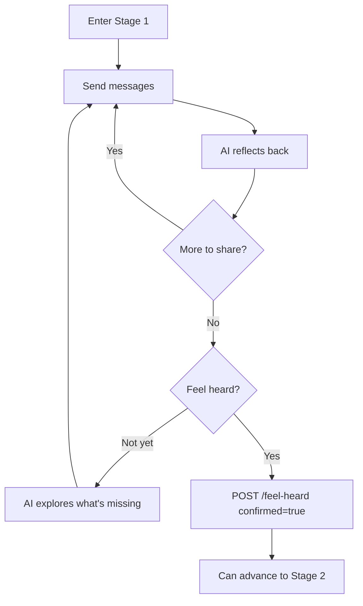

# Stage 1 API: The Witness

Endpoints for the witness stage - being heard by the AI.

Topic framing is complete before Stage 1 starts. The Stage 0 invitation flow owns `/sessions/:id/topic-frame/*`; Stage 1 message handlers should not generate or revise the invite topic frame.

## Send Message (streaming, primary)

Send a message and receive the AI response as a server-sent-event (SSE) stream. This is the active path.

```
POST /api/v1/sessions/:id/messages/stream
```

### SSE event types

The stream emits these event kinds until the connection closes:

| Event | Payload |
|-------|---------|
| `user_message` | `{ id: string; content: string; timestamp: string }` — server-confirmed user message (replaces optimistic copy) |
| `chunk` | `{ text: string }` — an incremental text fragment |
| `metadata` | `{ metadata: StreamMetadata }` — AI tool-call metadata, emitted before `text_complete` |
| `text_complete` | `{ metadata: StreamMetadata }` — AI text fully streamed (sent before DB persistence completes) |
| `complete` | `{ messageId: string; metadata: StreamMetadata }` — AI message persisted and stream closed |
| `error` | `{ message: string; retryable: boolean }` — stream-terminating error |

Where `StreamMetadata` carries optional fields from the AI's session-state tool call:

```typescript
interface StreamMetadata {
  offerFeelHeardCheck?: boolean;
  offerReadyToShare?: boolean;
  invitationMessage?: string;
  proposedEmpathyStatement?: string;
  proposedStrategies?: string[];
}
```

### Legacy non-streaming endpoint (deprecated)

```
POST /api/v1/sessions/:id/messages     # DEPRECATED — returns 410 Gone
```

This path now returns **HTTP 410 Gone**. All callers must use the streaming endpoint above.

## Get Initial Message

Generate the AI's first message for a session/stage (greeting, invitation-phase context, or Inner-Thoughts-seeded warm-up).

```
POST /api/v1/sessions/:id/messages/initial
```

The controller handles:
- First greeting when the session enters a stage for the first time.
- Special invitation-phase copy before the partner has accepted.
- Building context from a linked Inner Thoughts entry when present.

### Shared body (streaming + initial)

### Request Body

```typescript
interface SendMessageRequest {
  content: string;

  // Optional: include emotional reading with message
  emotionalIntensity?: number;  // 1-10
  emotionalContext?: string;
}
```

### Response

```typescript
interface SendMessageResponse {
  userMessage: MessageDTO;
  aiResponse: MessageDTO;

  // If emotional intensity is high
  suggestPause?: boolean;
  pauseReason?: string;
}
```

### Example

```bash
curl -X POST /api/v1/sessions/sess_abc123/messages \
  -H "Authorization: Bearer <token>" \
  -d '{
    "content": "I just feel like they never listen to what I need.",
    "emotionalIntensity": 6
  }'
```

```json
{
  "success": true,
  "data": {
    "userMessage": {
      "id": "msg_001",
      "sessionId": "sess_abc123",
      "senderId": "user_456",
      "role": "USER",
      "content": "I just feel like they never listen to what I need.",
      "stage": 1,
      "timestamp": "2024-01-16T15:30:00Z",
      "emotionalReading": {
        "id": "emo_001",
        "intensity": 6,
        "context": null,
        "stage": 1,
        "timestamp": "2024-01-16T15:30:00Z"
      }
    },
    "aiResponse": {
      "id": "msg_002",
      "sessionId": "sess_abc123",
      "senderId": null,
      "role": "AI",
      "content": "I hear that - feeling unheard is really painful. When you say they don't listen, what does that look like? Is it that they interrupt, or dismiss what you're saying, or something else?",
      "stage": 1,
      "timestamp": "2024-01-16T15:30:01Z"
    }
  }
}
```

### Stage 1 AI Behavior

In Stage 1, the AI:
- Reflects back what the user shares with empathy
- Uses paraphrase, emotion naming, and validation techniques
- Does NOT retrieve any partner data (Retrieval Contract enforced)
- May access user's own prior session content for continuity
- Focuses on helping user feel heard, not on solutions

### Side Effects

1. Message stored in `Message` table
2. UserEvent potentially created (for significant emotional content)
3. EmotionalReading stored if intensity provided
4. Embeddings generated asynchronously for semantic search

---

## Get Messages

Get message history for a session.

```
GET /api/v1/sessions/:id/messages
```

### Query Parameters

| Param | Type | Default | Description |
|-------|------|---------|-------------|
| `beforeSeq` | integer ≥ 1 | - | Return messages whose `seq` is strictly less (the older page) |
| `afterSeq`  | integer ≥ 1 | - | Return messages whose `seq` is strictly greater |
| `order`  | `asc` \| `desc` | `desc` | Sort order, by `seq` |
| `limit`  | number | 25 | Max results (1–500) |

Since work-k5fk.4 a message is keyed by its conversation and `seq` (its place in the conversation), the page is in
`seq` order and the cursors are seqs: a cursor on the instant could skip or repeat a line whose `created_at` disagrees
with its `seq` (step 7 review F3). Each `MessageDTO` carries `id` = `"<conversationId>:<seq>"` and `seq`. The
caller's MAIN conversation is the audience (target shape): the SQL below describes the old shape.

The query filters by both sender and visibility. Each message has an optional `forUserId` — only messages with `forUserId == null` (public) or `forUserId == <caller>` (addressed to the caller) are returned, enforcing cross-user data isolation at the read boundary:

```sql
WHERE (senderId = :userId AND forUserId IS NULL)
   OR forUserId = :userId
```

There is no `stage` filter or `cursor` token; pagination uses `beforeSeq`/`afterSeq` windows.

### Response

```typescript
interface GetMessagesResponse {
  messages: MessageDTO[];
  cursor?: string;
  hasMore: boolean;
}
```

---

## Confirm Feel Heard

Confirm that the user feels fully heard (Stage 1 gate requirement).

```
POST /api/v1/sessions/:id/feel-heard
```

### Request Body

```typescript
interface ConfirmFeelHeardRequest {
  confirmed: boolean;  // true = "I feel heard", false = "not yet"
}
```

### Response

```typescript
interface ConfirmFeelHeardResponse {
  confirmed: boolean;
  confirmedAt: string | null;
  canAdvance: boolean;
  partnerCompleted: boolean;
}
```

### Example: Confirming

```bash
curl -X POST /api/v1/sessions/sess_abc123/feel-heard \
  -H "Authorization: Bearer <token>" \
  -d '{"confirmed": true}'
```

```json
{
  "success": true,
  "data": {
    "confirmed": true,
    "confirmedAt": "2024-01-16T16:00:00Z",
    "canAdvance": true,
    "partnerCompleted": false
  }
}
```

### Example: Not Yet

```json
{
  "success": true,
  "data": {
    "confirmed": false,
    "confirmedAt": null,
    "canAdvance": false,
    "partnerCompleted": false
  }
}
```

### Side Effects (on `confirmed: true`)

1. Sets the caller's `feelHeardConfirmed` gate and stamps `confirmedAt`.
2. Triggers `consolidateGlobalFacts` to merge session insights into the user's global profile.
3. If the partner has an outstanding `HELD` empathy attempt, the asymmetric reconciler runs to decide whether to surface a share suggestion.
4. If both partners are now confirmed, publishes a session-wide `partner.advanced` event on the Ably session channel.

### UI Integration

When `confirmed: false`, the AI should:
1. Acknowledge the user isn't ready
2. Explore what's missing
3. Continue the witnessing process

```
AI: "I hear that you're not quite feeling fully heard yet.
     What feels like it's missing? Is there something specific
     you haven't had space to express?"
```

---

## Stage 1 Gate Requirements

To advance from Stage 1 to Stage 2:

| Gate | Requirement |
|------|-------------|
| `feelHeardConfirmed` | User explicitly confirms feeling heard |

**Note**: Partner does NOT need to complete Stage 1 for user to advance. Stages 1-3 are parallel.

---

## Stage 1 Flow



---

## Retrieval Contract

In Stage 1, the API enforces these retrieval rules:

| Allowed | Forbidden |
|---------|-----------|
| User's own messages | Partner's data of any kind |
| User's emotional readings | Shared Vessel content |
| User's prior session content (same relationship) | AI Synthesis Map |

See [Retrieval Contracts: Stage 1](../state-machine/retrieval-contracts.md#stage-1-the-witness).

---

## Related Documentation

- [Stage 1: The Witness](../../stages/stage-1-witness.md) - Full stage documentation
- [Emotional Barometer API](./emotional-barometer.md) - Emotion tracking
- [Chat Interface Wireframe](../../wireframes/chat-interface.md) - UI design

---

[Back to API Index](./index.md) | [Back to Backend](../index.md)
