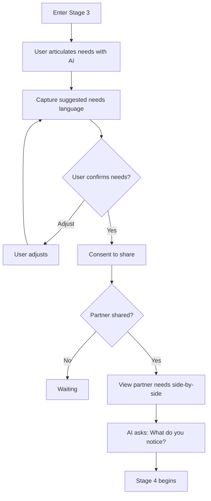

# Stage 3 API: What Matters

Endpoints for identifying needs, confirming them, and validating revealed needs with a partner.

## Overview

Stage 3 helps each user articulate what matters to them in needs language. Once both partners send their needs, the side-by-side reveal is available and Stage 4 can begin.

Key concepts:
- **Need articulation**: Each user chats with AI and names their own needs
- **Need confirmation**: User confirms the needs language before anything is shared
- **Needs consent**: User explicitly consents before confirmed needs are revealed
- **Needs reveal validation**: Both partners review the side-by-side reveal and validate it before Stage 4

---

## Get Stored Captured Needs

Get the current user's stored captured needs. This is a read-only endpoint; it never starts automatic extraction or background synthesis.

```
GET /api/v1/sessions/:id/needs
```

### Response

```typescript
interface GetNeedsResponse {
  needs: IdentifiedNeedDTO[];
  extracting: boolean;          // Deprecated compatibility field; always false
  synthesizedAt: string | null; // null when no needs exist
  isDirty: boolean;
}

interface IdentifiedNeedDTO {
  id: string;
  need: string;              // e.g., "Recognition"
  category: NeedCategory;    // SAFETY, CONNECTION, etc.
  description: string;       // Specific description
  evidence: string[];        // Quotes/references supporting this
  confirmed: boolean;
  aiConfidence: number;      // 0-1
  needsReframing?: boolean;  // true when wording appears strategy-shaped or other-person-focused
  reframingWarning?: string; // review copy shown before sharing
}

enum NeedCategory {
  SAFETY = 'SAFETY',
  CONNECTION = 'CONNECTION',
  AUTONOMY = 'AUTONOMY',
  RECOGNITION = 'RECOGNITION',
  MEANING = 'MEANING',
  FAIRNESS = 'FAIRNESS',
}
```

### Example Response

```json
{
  "success": true,
  "data": {
    "needs": [
      {
        "id": "need_001",
        "need": "Recognition",
        "category": "RECOGNITION",
        "description": "Need to feel seen and appreciated for contributions at home",
        "evidence": [
          "I cleaned the whole house and they did not even notice",
          "I feel like nothing I do is ever enough"
        ],
        "confirmed": false,
        "aiConfidence": 0.87
      },
      {
        "id": "need_002",
        "need": "Partnership",
        "category": "FAIRNESS",
        "description": "Need for shared responsibility in household tasks",
        "evidence": [
          "I am always the one who has to think about everything"
        ],
        "confirmed": false,
        "aiConfidence": 0.72
      }
    ],
    "extracting": false,
    "synthesizedAt": "2024-01-16T18:00:00Z",
    "isDirty": false
  }
}
```

### Behavior

`GET /needs` is a direct read — it returns the stored `IdentifiedNeed` rows for the caller without triggering AI extraction. Needs are created only through explicit capture or user add/edit actions after Stage 3 conversation. `extracting` is retained only as a deprecated compatibility field and is always `false`; `synthesizedAt` is `null` when no needs exist.

Validation: each need has evidence 1-5 items; `aiConfidence` 0-1. The response includes both `need` and `description` fields carrying the same string (`description` is a compatibility alias). Needs that look like demands, strategies, or other-person-focused wording are preserved but returned with `needsReframing` so the client can invite review rather than silently rewriting them.

---

## Capture Needs from AI Summary

Bulk-create needs from an AI-suggested summary card. This is the primary way needs are created in Stage 3 — the AI facilitates needs clarity during conversation, then the client calls this endpoint to persist the proposed needs for user review.

```
POST /api/v1/sessions/:id/needs/capture
```

### Request Body

```typescript
interface CaptureNeedsRequest {
  needs: Array<{
    need: string;          // Short label (e.g. "To feel heard")
    category: NeedCategory;
    description: string;   // Full sentence description
    evidence?: string[];   // Supporting quotes from conversation
  }>;
}
```

### Response

Returns `201 Created`:

```typescript
interface CaptureNeedsResponse {
  needs: IdentifiedNeedDTO[];
  capturedAt: string; // ISO timestamp
}
```

Validation: `needs` array required and non-empty; each item must have `need`, `description`, and a valid `category`. Captured needs are created with `confirmed: false` (user must confirm via `POST /needs/confirm` before consenting to share).

### Example Response

```json
{
  "success": true,
  "data": {
    "needs": [
      {
        "id": "need_003",
        "need": "To feel heard",
        "category": "CONNECTION",
        "description": "I want my concern to be understood before we solve it.",
        "evidence": ["I keep repeating myself because I do not think it landed."],
        "confirmed": false,
        "aiConfidence": 0.82
      }
    ],
    "capturedAt": "2026-05-05T18:00:00Z"
  }
}
```

---

## Confirm Needs

Confirm or adjust captured needs.

```
POST /api/v1/sessions/:id/needs/confirm
```

### Request Body

```typescript
interface ConfirmNeedsRequest {
  confirmations: NeedConfirmation[];
}

interface NeedConfirmation {
  needId: string;
  confirmed: boolean;
  adjustment?: string;  // If user wants to rephrase
}
```

### Response

```typescript
interface ConfirmNeedsResponse {
  updated: IdentifiedNeedDTO[];
  allConfirmed: boolean;
  canProceedToConsent: boolean; // true when at least one confirmed AND consent flow ready
}
```

Validation: confirmation required for each presented need; adjustment max 300 chars. Sets gate `needsConfirmed` for the caller. The response includes a `partnerConfirmed` boolean indicating whether the partner has reached the same gate (no separate `partnerNeedsConfirmed` field in the payload).

### Example

```bash
curl -X POST /api/v1/sessions/sess_abc123/needs/confirm \
  -H "Authorization: Bearer <token>" \
  -d '{
    "confirmations": [
      {"needId": "need_001", "confirmed": true},
      {"needId": "need_002", "confirmed": true, "adjustment": "Need for us to be a team at home"}
    ]
  }'
```

---

## Add Custom Need

Add a need that AI did not identify.

```
POST /api/v1/sessions/:id/needs
```

### Request Body

```typescript
interface AddNeedRequest {
  need: string;
  category: NeedCategory;
  description: string;
}
```

### Response

```typescript
interface AddNeedResponse {
  need: IdentifiedNeedDTO;
}
```

Validation: need/description 1-200 chars; category required. User-added needs are created with `confirmed: true` (they represent an explicit user declaration, not an AI guess).

---

## Interpret Need Edit Request

Preview an AI-owned need-list update from the user's natural-language instruction. This endpoint does not mutate stored needs.

```
POST /api/v1/sessions/:id/needs/interpret-edit-request
```

### Request Body

```typescript
interface InterpretNeedEditRequest {
  request: string;
  targetNeedId?: string;
  conversationHistory?: Array<{
    request: string;
    plan?: NeedEditPlan;
    clarification?: string;
  }>;
}
```

### Response

```typescript
interface InterpretNeedEditResponse {
  clarificationNeeded?: boolean;
  clarificationMessage?: string;
  plan?: NeedEditPlan;
}

interface NeedEditPlan {
  summary: string;
  operations: NeedEditOperation[];
  affectedNeeds: AffectedNeed[];
}

type NeedEditOperation =
  | { type: 'updateNeedText'; needId: string; newText: string; newCategory?: NeedCategory }
  | { type: 'addNeed'; text: string; category?: NeedCategory }
  | { type: 'removeNeed'; needId: string };
```

Interpretation fetches only the caller's own unshared needs. Ambiguous instructions return a clarification. Valid instructions return a preview with before/after affected needs for the client diff UI.

---

## Apply Need Edits

Apply a previously previewed edit plan transactionally.

```
POST /api/v1/sessions/:id/needs/apply-edits
```

### Request Body

```typescript
interface ApplyNeedEditsRequest {
  operations: NeedEditOperation[];
}
```

### Response

```typescript
interface ApplyNeedEditsResponse {
  needs: IdentifiedNeedDTO[];
  affectedNeeds: AffectedNeed[];
  warnings: string[];
}
```

The apply path revalidates ownership and the `needsShared` gate. If the caller has already shared needs, apply fails; already-shared needs require a later-stage correction path rather than silent mutation.

---

## Remove Need

Remove one of the caller's unshared needs.

```
DELETE /api/v1/sessions/:id/needs/:needId
```

Returns the updated `IdentifiedNeedDTO[]`. The delete path is limited to the caller's own vessel and refuses mutation after `needsShared`.

---

## Consent to Share Needs

Consent to share confirmed needs with partner.

```
POST /api/v1/sessions/:id/needs/consent
```

### Request Body

```typescript
interface ConsentShareNeedsRequest {
  needIds: string[];  // Which needs to share
}
```

### Response

```typescript
interface ConsentShareNeedsResponse {
  consented: boolean;
  sharedAt: string;
  waitingForPartner: boolean;
  needsRevealReady: boolean;
}
```

### Side Effects

1. Creates `ConsentRecord` rows with `targetType = IDENTIFIED_NEED`
2. Sets the caller's `needsShared` gate
3. Notifies clients when both users have consented and the side-by-side reveal is ready

Validation: needIds must reference confirmed needs; at least 1. Consenting records the caller's share (`need_share`; `GET /sessions/:id/needs` then reports `sharedAt`). Once every present human has shared, the job writes the session-scoped `needs_validated` and `needs_shared` milestones for all of them (ruling R33) and both move to Stage 4; until then the caller stays IN_PROGRESS in Stage 3 and `needs_shared` is absent from every progress `milestones` map.
When both partners have sent needs, the backend completes Stage 3 for both sides and opens Stage 4. The legacy `needsValidated` gate is populated automatically for compatibility; there is no second user-facing accuracy confirmation.

---

## Compare Needs (Side-by-Side)

After both partners share needs, the app can render a side-by-side comparison of each user's confirmed/shared needs:

```
GET /api/v1/sessions/:id/needs/comparison
```

> **Alias**: `GET /api/v1/sessions/:id/needs/reveal` routes to the same handler for clients using the Stage 3 capture/consent/reveal/validation vocabulary.

Returns each partner's needs grouped for display. This supports the side-by-side reveal and Stage 4 orientation.

---

## Validate Needs (Legacy Compatibility)

Older clients can still call this endpoint to mark the side-by-side reveal reviewed. New clients should treat `POST /needs/consent` as the decisive user-facing action: once both partners send needs, Stage 4 opens automatically.

```
POST /api/v1/sessions/:id/needs/validate
```

### Request Body

```typescript
interface ValidateNeedsRequest {
  validated?: boolean;  // Defaults to true if omitted
}
```

### Response

```typescript
interface ValidateNeedsResponse {
  validated: boolean;
  validatedAt: string | null;
  partnerValidated: boolean;
  canAdvance: boolean;  // true when this compatibility call opens Stage 4
}
```

### Side Effects

Calling this endpoint with `validated !== false` sets the caller's `needsValidated` compatibility gate.

When both partners have the compatibility gate (`canAdvance === true`):
1. Both partners' Stage-3 status transitions to `COMPLETED`
2. Both partners' Stage-4 progress records are created (`IN_PROGRESS`)
3. A transition message is published to both users

Pre-conditions: both partners must have consented to share needs (`needsShared` gate) before calling this endpoint. The `hasPartnerSharedNeeds` check is enforced server-side.

### Example Response

```json
{
  "success": true,
  "data": {
    "validated": true,
    "validatedAt": "2026-05-05T18:05:00Z",
    "partnerValidated": false,
    "canAdvance": false
  }
}
```

---

## Stage 3 Gate Requirements

To advance from Stage 3 to Stage 4:

| Gate | Requirement |
|------|-------------|
| `needsConfirmed` | Caller confirmed at least one need |
| `needsShared` | Caller consented to share confirmed needs |
| `needsValidated` | Compatibility gate set automatically once both partners have sent needs |

Who has shared is a fact of `need_share` (the caller's own: `GET /needs` `sharedAt`); `needs_shared` is reached by both at the second share. Stage-3 status transitions: `IN_PROGRESS` → `COMPLETED` (as soon as both partners have shared).

---

## Stage 3 Flow



---

## Retrieval Contract

In Stage 3, the API enforces these retrieval rules:

| Allowed | Forbidden |
|---------|-----------|
| User's identified needs | Partner's raw events |
| Shared Vessel (consented needs) | Non-consented partner needs |
| Partner's revealed needs (after both consent) | Partner's UserVessel |

Vector search is scoped to needs only (not raw events).

See [Retrieval Contracts: Stage 3](../state-machine/retrieval-contracts.md#stage-3-what-matters).

---

## Related Documentation

- [Stage 3: What Matters](../../stages/stage-3-what-matters.md)
- [Universal Needs Framework](../../stages/stage-3-what-matters.md#universal-needs-framework)

---

[Back to API Index](./index.md) | [Back to Backend](../index.md)
