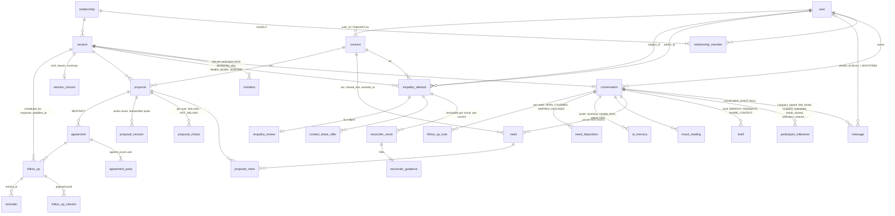

# Schema Design Review — October 2026

Scope: `backend/prisma/schema.prisma` at migration 76 (uuidv7 ids). Inputs: the product journey
(`database-redesign-user-flow.md`), the August audit and ERD, the approved Phase 3 security design,
the vessel and reconciler docs, and a production call-site grep over `backend/src` (method in §11).
Severity: **P0** data can be wrong or leak · **P1** design debt that will cost soon · **P2** polish.
Line numbers are `schema.prisma` lines; `cs=n` is production call sites (`prisma.<model>.`).

---

## 0. Verdict

| # | Sev | Finding | Pointer |
|---|---|---|---|
| 1 | **P0** | **The privacy boundary is not a row.** A participant's private conversation — the thing the whole visibility table is about — has no table. It is `Session` + a nullable, FK-less `Message.forUserId` (l.656), plus `UserVessel` carrying read-state and AI memory. Partner-facing facts hang off positional slots (`agreedByA/B`, `confirmedByA/B`, "first member by `joinedAt` is A", `stage4.ts:54`) and unenforced `guesserId/subjectId` text. Make **`conversation`** (session × participant) a first-class row and key messages, drafts and memory on it; make empathy **direction** explicit (`author_id`, `subject_id`). | §2.1, §3.3, §7 |
| 2 | **P1** | **The state machine lives in a blob.** `StageProgress.gatesSatisfied` (l.345) is written from 20 files / 175 sites and holds booleans, ISO timestamps, a walkthrough phase, and **need ids** (`coveredNeedIds`, `skippedNeedIds`, `currentNeedId`, `stage4.ts:506`). Replace with a `participant_milestone` event table and a `need_disposition` junction; derive "stage" as a view. | §3.2, §6 |
| 3 | **P1** | **Three of everything.** Conversations ×3 (`UserVessel`, `InnerWorkSession`, `Stage4SubChat`), messages ×3, drafts ×2 (`EmpathyDraft`, `ValidationFeedbackDraft`), consent ×2 (`ConsentRecord`, `ConsentedContent`), need-link ×2 (`StrategyProposal.needsAddressed[]` 58 refs vs the `StrategyProposalNeed` junction 11 refs). Each duplicate is another RLS policy set, another encryption map entry, another deletion path. Unify to one `conversation`, one `message`, one `draft`, one `consent`. | §1, §2, §3.1 |
| 4 | **P1** | **A third of the schema is speculative.** 23 of 68 models have ≤3 production call sites; `CommonGround` and `TakeawayLink` have 0; `RecurringTheme`, `UserEvent`, `Boundary`, `UserDocument` are written only by the deletion path. Eight wellbeing tables, three needs-assessment tables and the people tracker are feature prototypes carrying 11 `jsonb`/array columns between them. Collapse to per-user feature documents or drop; keep only what a job or a list query filters in SQL. | §4 |
| 5 | **P2** | **Postgres is a bystander.** 0 CHECKs, 0 views, 0 triggers (audit §1); 144 naive timestamps; 9 free-text statuses (`Stage4ProposalRevision.action` holds `'CONVERTED'`, `'covered'` and `'subchat_refined'` in the same column); `MeditationStats` and `Stage4NeedCoverage` are hand-maintained caches of things a view computes. | §3.5, §5, §6 |
| — | **Order** | **Re-shape before Phase 3 W8–W10, not after.** Phase 3 writes four policies, column grants and triggers per table on the *current* 71-table shape; every rename afterwards redoes that work. Production is 9 users; the golden harness is the oracle. W0–W6 (roles, identity, CHECKs, FKs) are shape-independent and can proceed; policies should land on the target shape. | §7, §8 |

### Disposition — all 68 models

`keep` may still mean rename to snake_case and add constraints (§5). Target names in §9.

| Model | cs | Disposition | Reason |
|---|---|---|---|
| User | 61 | **split** | identity stays; device/auth flags → `user_device`; 3 preference blobs + 2 wellbeing prefs → `user_preferences`; `globalFacts` → `ai_memory`; `lastMoodIntensity` → view over `mood_reading` |
| Relationship | 6 | keep | root of membership; add CHECK "exactly 2 members" via trigger or deferred constraint |
| RelationshipMember | 16 | keep | one row per user per relationship (unique exists); `role` text → enum |
| Session | 121 | keep | trim: drop `type` (`INNER_WORK` never written, `brain.ts` only), `WAITING`/`PAUSED` are per-participant states → milestones |
| StageProgress | 154 | **split** | → `participant_milestone` (event rows) + `need_disposition`; stage becomes a view |
| UserVessel | 51 | **rename** → `conversation` | it already *is* session × user, unique; read-state and AI memory move to `conversation_read_state` / `ai_memory` |
| UserEvent | 1 | drop-until-needed | written by nobody, read by nobody; deletion path only |
| EmotionalReading | 6 | keep → `mood_reading` | time series, filtered by DB (`emotions.ts`) |
| IdentifiedNeed | 42 | keep → `need` | core entity; absorb `ConsentedContent` columns (1:1 via `originalNeedId @unique`) |
| Boundary | 1 | drop-until-needed | deletion path only |
| UserDocument | 1 | drop-until-needed | deletion path only; `type` free text |
| SharedVessel | 11 | **merge-into** Session | 1:1 container with no columns of its own; children key on `session_id` |
| ConsentedContent | 4 | **merge-into** need | 1:1 with `IdentifiedNeed`; becomes `shared_text`, `consent_id`, `revoked_at` on `need` |
| CommonGround | 0 | drop | no production reader or writer; `confirmedByA/B` positional |
| Agreement | 10 | keep | replace `agreedByA/B` with `agreement_party` junction (or derive from `proposal_choice`) |
| ConsentRecord | 18 | keep → `consent` | polymorphic `targetId` → exclusive-arc FK columns + CHECK |
| Message | 95 | keep | `conversation_id` FK replaces `sessionId`+`forUserId`; `role` splits into `role` + `kind`; drop `extractedNeeds/Emotions` |
| PreSessionMessage | 2 | drop-until-needed | structural island, 24h TTL rows, 2 call sites |
| InnerWorkSession | 41 | **merge-into** conversation | `kind = INNER_WORK`; inner-work-only columns nullable with CHECK per kind |
| InnerWorkMessage | 12 | **merge-into** message | same shape as `Message` minus routing |
| SessionTakeaway | 12 | keep → `takeaway` | browsed and filtered (knowledge base); embedding per D8 moves to app |
| TakeawayLink | 0 | drop | no production call sites; similarity links derivable |
| EmpathyDraft | 17 | **merge-into** draft | `draft(conversation_id, kind, …)` unique per kind |
| EmpathyAttempt | 52 | keep → `empathy_attempt` | add `subject_id`; rows immutable per submission with `round`; unique (session, author, round) |
| EmpathyValidation | 7 | keep → `empathy_review` | one per attempt per reviewer (unique exists) |
| ValidationFeedbackDraft | 1 | **merge-into** draft | identical shape to `EmpathyDraft` |
| ReconcilerResult | 22 | keep | FK `attempt_id`; `subject_id` FK (RLS arm); drop `guesserName/subjectName`; `ReconcilerGuidance` split per Phase 3 D8a |
| ReconcilerShareOffer | 29 | keep → `context_share_offer` | `userId` → FK; status enum already |
| RefinementAttemptCounter | 2 | drop → view | `count(*)` of `reconciler_result` per attempt; `direction` string is a composite key in disguise |
| StrategyProposal | 37 | keep → `proposal` | drop `needsAddressed[]` in favour of the junction; FK `parent_proposal_id`, `captured_from_message_id` |
| StrategyProposalNeed | 3 | keep → `proposal_need` | the one real junction; make it the only need link |
| Stage4ProposalSelection | 10 | keep → `proposal_choice` | willingness per user per proposal (unique exists) |
| Stage4ProposalRevision | 9 | keep → `proposal_revision` | audit log; `action` → enum; `before/after` jsonb with `jsonb_typeof = 'object'` CHECK; FKs on `sessionId`, `actorUserId`, `messageId` |
| Stage4NeedCoverage | 11 | **view** + merge-into need_disposition | coverage = `proposal_need` × `proposal_choice`; user-set covered/skipped → `need_disposition` |
| Stage4NeedDeclination | 5 | **merge-into** need_disposition | a declination is `status = DECLINED` |
| Stage4Closure | 13 | keep → `session_closure` | drop the three id arrays (derivable); `closedByUserId` → FK |
| Stage4SubChat | 6 | **merge-into** conversation | `kind = SUBCHAT`, `anchor_kind`, `anchor_proposal_id` FK |
| Stage4SubChatMessage | 2 | **merge-into** message | |
| TendingEntry | 27 | keep → `follow_up` | job-queried (`scheduledFor` index); `ownerUserId` → FK |
| TendingCheckin | 3 | keep → `follow_up_checkin` | gains `payload jsonb` absorbing the five response tables |
| TendingCoordinationCycle | 9 | drop → view | three id arrays; status derivable from check-ins vs `response_deadline_at` on the entry |
| TendingResponse | 3 | **merge-into** checkin payload | `status` free text; read back only with its check-in |
| TendingEntryOutcome | 1 | **merge-into** checkin payload | |
| TendingNeedOutcome | 1 | **merge-into** checkin payload | `needLabel` is a denormalised copy |
| TendingReminder | 4 | keep → `reminder` | job-queried (`remindAt`); `status` → enum |
| TendingAdjustment | 1 | **merge-into** checkin payload | |
| TendingBetweenPeriodNote | 6 | keep → `follow_up_note` | created between check-ins; has a consent flag |
| TendingResponsePartialClosure | 1 | **merge-into** checkin payload | |
| StrategyRanking | 7 | drop-until-needed | product flow is willingness selection, not ranking; `rankedIds[]` |
| EmotionalExerciseCompletion | 3 | keep → `regulation_event` | per session/user time series |
| GlobalLibraryItem | 2 | drop-until-needed | island; `contributedBy` no FK; curated content belongs in code/seed until it is user-contributed |
| Invitation | 23 | keep | add `accepted_by_user_id` (Phase 3 §6) |
| UserMemory | 23 | keep | filtered by status/category/session |
| Need | 6 | **lookup** → `need_taxonomy` | fix `Int @id` with no generator (audit §2); keep seeded |
| NeedScore | 4 | keep | `DISTINCT ON` time-series queries in 4 raw-SQL sites |
| NeedsAssessmentState | 8 | **jsonb-table** | per-user feature state, read whole; `nextCheckInAt` promoted to a column if a job ever queries it |
| Person | 19 | keep (slim) | unique (user, name); drop 4 counters and `needsConnections` → derive |
| PersonMention | 8 | **jsonb-table** | polymorphic `sourceId`; mentions become a `jsonb` array on `person` until something filters them |
| Insight | 4 | keep | already the jsonb-document pattern done right (`data jsonb` + typed filter columns) |
| RecurringTheme | 1 | drop → view | `group by theme` over conversations; cached summary → `ai_memory` |
| GratitudeEntry | 9 | keep (slim) → `gratitude_entry` | five tag arrays + `linkedNeedIds` + sentiment → one `extracted jsonb` |
| GratitudePreferences | 3 | **merge-into** user_preferences | |
| MeditationSession | 7 | keep | time series listed by date; drop `linkedNeedIds`, `linkedConflictId` (0 refs) |
| MeditationStats | 5 | **view** | streaks and totals are `count/sum` over `meditation_session` |
| MeditationFavorite | 5 | **merge-into** `meditation_script` | same thing as `SavedMeditation` with a `favorite_type` |
| MeditationPreferences | 3 | **merge-into** user_preferences | |
| SavedMeditation | 8 | keep → `meditation_script` | `conversationId` → FK conversation |
| BrainActivity | 20 | keep | telemetry; jsonb legitimate; retention per Phase 3 |

Tally (68): keep 32 · split 2 · rename 1 · merge-into 17 · view 5 · jsonb-table 2 · lookup 1 · drop / drop-until-needed 8. Target: **~40 tables** (+ `ReconcilerGuidance`, `UserKey`, `SessionKey` from Phase 3).

---

## 1. The premise, corrected

The owner's reading — "the User table contains relationships, messages, preferences, reminders …
pretty much everything is listed as an array" — comes from the 52 lines of `Foo[]` fields on
`User` (l.45–96) and 31 on `Session` (l.142–174). Those are Prisma **back-relations**: virtual,
no column, generated from the FK on the child. The `User` table has 16 columns; the relational
connections the owner feared were missing *do* exist as child tables with FKs (118 of them).
That correction stands once, and the rest of the concern survives it intact:

| Concern | Status | Where |
|---|---|---|
| God tables | **Real** — `User` mixes identity, auth device, four `jsonb` preference/memory blobs and a mood cache; `UserVessel` mixes private-vessel root, read-state and AI memory; `Message` mixes routing, content, event-kind and extraction | §2 |
| Real arrays | **Real** — 27 array columns, 10 of them id lists with no FK (audit §3b), plus `needsAddressed[]` shadowing a junction | §3.1 |
| JSON hiding structure | **Real** — `gatesSatisfied` holds need ids and timestamps; `Stage4ProposalRevision.before/after` is unshaped; `conversationSummary` is JSON serialised into `text` ×2 | §3.2 |
| Over-specification | **Real** — 23 models ≤3 call sites; 2 with none | §4 |
| Coupling | **Real** — 127 back-relations say 60+ tables reach `User`/`Session` directly rather than through a domain parent | §2, §6 |

---

## 2. God tables and mixed concerns

### F2.1 `User` — identity, device, preferences, AI memory and mood in one row (P1)

| Columns (l.22–43) | Concern | Target |
|---|---|---|
| `id, clerkId, email, name, firstName, lastName, createdAt, updatedAt` (+ `deletedAt` tombstone, Phase 3 D9) | identity | `user` |
| `pushToken, biometricEnabled, biometricEnrolledAt` | device/auth | `user_device` (one row per device; today one token per user silently overwrites a second phone) |
| `memoryPreferences, notificationPreferences, privacyPreferences` jsonb | preferences | `user_preferences(user_id PK, prefs jsonb)` with `CHECK (jsonb_typeof(prefs)='object')`; shapes are the three DTOs in `shared/src/dto/auth.ts:59–184` and are read whole — legitimately schemaless |
| `globalFacts` jsonb (`[{category, fact}]`, max 50) | AI memory | `ai_memory` document table (§4 criterion: LLM output, read whole, never filtered) |
| `lastMoodIntensity` | cache | view over `mood_reading` (`emotions.ts:112` writes both) |

Why it matters beyond tidiness: Phase 3 makes `User` a bespoke RLS table precisely because a
co-member policy "would leak `email`, `pushToken`, `globalFacts`" (design §2). Splitting removes
the leak surface instead of policing it, and the tombstone scrub (design §7) becomes `DELETE FROM
user_device / user_preferences / ai_memory` plus a 4-column update.

### F2.2 `UserVessel` is the missing `conversation` (P0, with F3.3)

`UserVessel` (l.367–418) is unique on `(userId, sessionId)` and is the parent of the private
vessel children — but the private *conversation* (messages, drafts) does not key on it. Messages
key on `sessionId` and are routed by `forUserId`. Result: the row that should own a participant's
private thread exists, and the thread is attached somewhere else.

| Today | Target |
|---|---|
| `UserVessel(userId, sessionId)` + children `UserEvent/Boundary/UserDocument/EmotionalReading/IdentifiedNeed` | `conversation(id, session_id, user_id, kind)`; `need`, `mood_reading` key on it |
| `lastViewedAt, lastSeenChatItemId, lastViewedShareTabAt, lastActiveAt, archivedAt` | `conversation_read_state` (hot, UPDATE-heavy, no partner visibility) |
| `conversationSummary text(JSON)`, `notableFacts jsonb`, `contentEmbedding` | `ai_memory(conversation_id)` jsonb doc; embedding per D8 |

### F2.3 `Message` — routing, content, event kind and extraction (P1)

- `role` (l.685–695) holds three actors (`USER/AI/SYSTEM`) and six **event kinds**
  (`EMPATHY_STATEMENT`, `SHARED_CONTEXT`, `VALIDATION_FEEDBACK`, …). Split: `role` (who speaks) ×
  `kind` (what it is). Phase 3's CHECK "humans can't author as AI" then reads `role='AI' ⇒ sender_id IS NULL` cleanly.
- `extractedNeeds[]`, `extractedEmotions[]` (l.674–675): 4 and 10 references, none a reader that filters. Drop.
- `forUserId`: see F3.3.
- `contentHash`, `refiningNeedId`, `stage`: keep (`stage` becomes derivable but is cheap denormalisation for the chat list).

### F2.4 `Session` — fine, slightly over-stated (P2)

`status` (l.192–201) mixes session facts (`CREATED/INVITED/ACTIVE/RESOLVED/ABANDONED`) with
per-participant facts (`WAITING`, `PAUSED`, `ARCHIVED` — archiving is already per-vessel,
`UserVessel.archivedAt`). `type = INNER_WORK` (l.188) is never written outside `brain.ts`
(`InnerWorkSession` is the real thing). Keep the table; shrink the enum; `topicFrame*` stays.

### F2.5 Splits that would be churn

`EmpathyAttempt` (status + delivery + revision fields) and `ReconcilerShareOffer` (offer + delivery
+ notification timestamps) look wide but each row is one lifecycle; splitting delivery tracking out
gains nothing a view can't. Keep.

---

## 3. Normalisation and integrity

### F3.1 Arrays — 27 columns, three kinds (P1)

| Kind | Columns | Disposition |
|---|---|---|
| Id lists (10, audit §3b) | `Stage4Closure.{sharedAgreementIds,individualProposalIds,openNeedIds}`, `Stage4NeedCoverage.coveringProposalIds`, `StrategyRanking.rankedIds`, `TendingCoordinationCycle.{entryIds,participantUserIds,submittedUserIds}`, `GratitudeEntry.linkedNeedIds`, `MeditationSession.linkedNeedIds` | 6 become **derivable** once `need_disposition`, `proposal_choice` and `follow_up_checkin` exist (closure ×3, coverage, cycle ×2); `participantUserIds` is `RelationshipMember`; `rankedIds` goes with `StrategyRanking`; the two `linkedNeedIds` have 6 refs combined → drop |
| Shadow of a junction (1) | `StrategyProposal.needsAddressed[]` (l.974) — 58 refs; the `StrategyProposalNeed` junction has 11 | **P1**: the app reads the array, the FK-enforced junction is nearly decorative. Keep the junction, drop the array, backfill once |
| Tag bags (16) | `IdentifiedNeed.evidence`, `UserEvent.emotions`, `ReconcilerResult.{correctlyIdentified,missedFeelings,misattributions}`, `GratitudeEntry.extracted*` ×5, `Person.aliases`, `GratitudePreferences.preferredTimes`, `TendingEntryOutcome.blockerCategories`, `TendingAdjustment.blockerAddressed`, `Message.extracted*` ×2 | `text[]` of LLM output that is never joined is acceptable Postgres; fold the five gratitude arrays into one `extracted jsonb`; drop the two on `Message` |

### F3.2 JSON — 17 `jsonb` + 2 JSON-in-`text` (P1)

| Column | Verdict | Why |
|---|---|---|
| `StageProgress.gatesSatisfied` (l.345) | **hides structure — P1** | 20 files write it; keys include `compactSigned/signedAt`, `feelHeardConfirmed/At`, `needsConfirmed`, `needsShared`, `selectionSubmitted`, and Stage 4 `phase/currentNeedId/coveredNeedIds/skippedNeedIds` (`stage4.ts:504–508`). Each boolean+timestamp pair is a **milestone event**; each id list is a **junction**. Target: `participant_milestone(conversation_id, milestone enum, at timestamptz, UNIQUE)` + `need_disposition(conversation_id, need_id, status enum)` |
| `Stage4ProposalRevision.before/after` | acceptable as audit diff | add `CHECK (jsonb_typeof(before)='object')`; `action` → enum (F3.5) |
| `StrategyProposal.coverageSummary` | drop | 5 refs; derivable from the junction |
| `Person.needsConnections`, `MeditationStats.favoriteFocusAreas` | drop | counters of derivable things |
| `ConsentRecord.metadata`, `Insight.data`, `BrainActivity.{input,output,metadata,structuredOutput}` | legitimate | telemetry / LLM payloads, read whole |
| `User.{memory,notification,privacy}Preferences` | legitimate | → `user_preferences` (F2.1) |
| `User.globalFacts`, `UserVessel.notableFacts`, `UserVessel.conversationSummary` (text), `InnerWorkSession.conversationSummary` (text) | legitimate, mis-homed | → `ai_memory` jsonb; the two `text` columns become real `jsonb` (audit §6) |

### F3.3 Id columns with no FK — 31 by catalog, 26 after false positives (P0 for the first row)

| Group | Columns | Fix |
|---|---|---|
| **The audience column** | `Message.forUserId` text NULL (l.656) | Replaced by `message.conversation_id NOT NULL FK`. Phase 3 §3 planned `forUserId NOT NULL + FK RESTRICT` with backfill `forUserId = senderId`; the same backfill produces `conversation_id` (`conversation` row for `(sessionId, coalesce(forUserId, senderId))`). Predicate becomes `conversation.user_id = me OR sender_id = me` — identical semantics, one hop, and now a *typed* parent row instead of a text column |
| Direction without FKs | `ReconcilerResult.guesserId/subjectId`, `ReconcilerShareOffer.userId`, `RefinementAttemptCounter.direction` ("a->b" string, l.955) | `empathy_attempt.author_id/subject_id` FK; results/offers FK the attempt; counter becomes a count |
| Mandatory, unenforced (audit §3a) | `PersonMention.userId/sourceId`, `Stage4NeedDeclination.userId/needId`, `Stage4ProposalRevision.sessionId`, `PreSessionMessage.userId` | three tables go (§0); revision gets FKs |
| Polymorphic | `ConsentRecord.targetId/targetType` (7 kinds), `PersonMention.sourceId` (4), `Stage4SubChat.anchorId` (3) | **Exclusive arc**: one nullable FK column per real target (`need_id`, `empathy_attempt_id`, `proposal_id`, …) + `CHECK (num_nonnulls(need_id, empathy_attempt_id, proposal_id, …) = 1)`. Postgres has no FK-to-many; this is the idiom that keeps referential integrity and lets each arm cascade correctly. `targetType` becomes a generated column if the app still wants it |
| Optional cross-links | `StrategyProposal.parentProposalId/capturedFromMessageId`, `Stage4Closure.closedByUserId`, `TendingEntry.ownerUserId`, `Stage4ProposalRevision.actorUserId/messageId`, `SavedMeditation.conversationId`, `NeedsAssessmentState.lastCheckInNeedId`, `UserVessel.lastSeenChatItemId` | plain FKs (`RESTRICT` to user, `SET NULL` to content) |
| Not relations | `User.clerkId`, `MeditationSession.voiceId`, `BrainActivity.turnId` | leave |

### F3.4 Denormalised copies, caches, positional slots (P0/P1)

| Column(s) | Problem | Fix |
|---|---|---|
| `Agreement.agreedByA/agreedByB`, `CommonGround.confirmedByA/B` | **P0** — "A" is "first `RelationshipMember` by `joinedAt`" (`stage4.ts:54–80`); the slot is recomputed on every call, ties on `joinedAt` are undefined, and a tombstoned member keeps its slot | `agreement_party(agreement_id, user_id, agreed_at)`; or derive agreement from two `WILLING` rows in `proposal_choice`, which is what the product spec says an agreement *is* |
| `ReconcilerResult.guesserName/subjectName` | copies of `User.name` the deletion path must scrub | drop; join |
| `Stage4NeedCoverage.needLabel`, `TendingNeedOutcome.needLabel/changedNeedLabel` | copies of `need.need` | drop; FK |
| `Person.mentionCount*` ×4, `MeditationStats.*`, `RecurringTheme.sessionCount` | hand-maintained aggregates | views |
| `User.name` "computed from firstName + lastName" | stored computed | `GENERATED ALWAYS AS (…) STORED` or drop |
| `EmpathyAttempt.revisionCount`, `ReconcilerResult.iteration`, `RefinementAttemptCounter.attempts` | three counters of the same loop | one: `count(*)` over immutable attempt rows |

### F3.5 Missing uniques, CHECKs, enums (P1)

Uniques that exist and are right: `RelationshipMember(relationshipId,userId)`, `UserVessel(userId,sessionId)`,
`EmpathyDraft(sessionId,userId)`, `EmpathyValidation(attemptId,userId)`, `Stage4ProposalSelection(proposalId,userId)`,
`StageProgress(sessionId,userId,stage)`, `StrategyProposalNeed` PK, the partial unique on
`TendingCoordinationCycle` (ERD §3.4). Missing:

| Table | Should be unique | Today |
|---|---|---|
| `EmpathyAttempt` | `(session_id, author_id, round)` | `(sessionId, sourceUserId)` with nullable `sourceUserId` — the schema comment (l.781–783) admits NULLs defeat it; and uniqueness-per-session forbids the immutable-per-submission history the product spec requires ("a later private edit must not silently change what the partner was shown") |
| `ReconcilerResult` | one *current* per attempt: `UNIQUE (attempt_id) WHERE superseded_at IS NULL` | none |
| `ReconcilerShareOffer` | `(attempt_id, iteration)` | `resultId @unique` only |
| `Relationship` | exactly two members | nothing; `getUserSlot` returns `null` under 2 |
| `participant_milestone` | `(conversation_id, milestone)` | n/a (jsonb) |
| `Session` | at most one `ACTIVE` per relationship? | **open question**, §10 |

CHECKs: Phase 3 §6 lists seven; add `mood_reading.intensity BETWEEN 1 AND 10`,
`empathy_attempt.author_id <> subject_id`, `need_score.score IN (0,1,2)`, `jsonb_typeof` on every
jsonb column, and the exclusive-arc checks (F3.3).

Free-text statuses (ERD §3.5 lists 9). Observed values: `Stage4ProposalRevision.action` =
`CREATED | REVISED | REMOVED | RESTORED | CONVERTED | CAPTURE_SKIPPED | covered | subchat_refined`
(mixed case, two styles); `TendingReminder.status` = `SCHEDULED | DELIVERED | RESOLVED`;
`RelationshipMember.role` = `member` only. All nine → Postgres enums. Enum lifecycle: adding a
value is `ALTER TYPE … ADD VALUE` (non-transactional, fine); removing one is a rebuild — which is
why `EmpathyStatus` still carries `NEEDS_WORK` and `ANALYZING` and `ReconcilerShareStatus` carries
two "legacy" values. Acceptable; or use a lookup table only where values are user-visible labels
(none are).

---

## 4. Over-specification

**Criterion.** A table earns its place if at least one of: (a) a query filters or sorts on its
columns in SQL (list, job, index); (b) it is joined to another table; (c) it carries an RLS or
consent predicate of its own. Otherwise it is a document: one `jsonb` row per owner, or nothing.

**Evidence.** The parallel census (`scratchpad/schema-census/census.md`) was not written when this
section was produced; counts here are from `grep -rn 'prisma.<model>.\|tx.<model>.' backend/src`
excluding `*.test.*`, `__tests__`, `fixtures`, `scripts/`, `src/testing/`, `e2e/`, `generated/`
(§11). Mobile surface checked with `grep -rl` over `mobile/src` and `mobile/app`.

| Cluster | Tables (cs) | (a) | (b) | (c) | Disposition |
|---|---|---|---|---|---|
| Private vessel children | `UserEvent` 1, `Boundary` 1, `UserDocument` 1 | no | no | inherit | **drop-until-needed**; the only call is `session-deletion.ts` |
| Shared vessel | `SharedVessel` 11, `CommonGround` 0 | no | container only | inherit | merge / drop |
| Pre-session | `PreSessionMessage` 2 | TTL index | no | own | drop-until-needed; if revived, a `conversation` of kind `PRE_SESSION` |
| Stage 2 drafts | `ValidationFeedbackDraft` 1 | no | no | own | merge into `draft` |
| Stage 4 bookkeeping | `Stage4NeedCoverage` 11, `Stage4NeedDeclination` 5, `StrategyRanking` 7 | coverage listed per session | yes | inherit | coverage → view + `need_disposition`; ranking → drop-until-needed (product spec: willingness, not rank) |
| Tending responses | `TendingResponse` 3, `EntryOutcome` 1, `NeedOutcome` 1, `Adjustment` 1, `PartialClosure` 1, `CoordinationCycle` 9 | only the cycle (deadline) | only to their check-in | inherit | five → `checkin.payload jsonb`; cycle → view with `response_deadline_at` on `follow_up` |
| Knowledge base | `SessionTakeaway` 12, `TakeawayLink` 0, `RecurringTheme` 1 | takeaways browsed/filtered (mobile 9 files) | links no | own | takeaway keep; link drop; theme → view |
| People | `Person` 19, `PersonMention` 8 | person list by `lastMentioned`; mentions by `(userId, sourceType)` | mention → person | own | person keep (slim); mention → jsonb on person until a filter needs it |
| Needs assessment | `Need` 6, `NeedScore` 4, `NeedsAssessmentState` 8 | scores: `DISTINCT ON` in 4 raw-SQL sites | yes | own | taxonomy + scores keep; state → feature doc |
| Gratitude | `GratitudeEntry` 9, `GratitudePreferences` 3 | entries by date | no | own | entry keep (slim); prefs → `user_preferences` |
| Meditation | `MeditationSession` 7, `Stats` 5, `Favorite` 5, `Preferences` 3, `SavedMeditation` 8 | sessions by date | no | own | session keep; stats → view; favorite+saved → `meditation_script`; prefs → `user_preferences` |
| Insights | `Insight` 4 | by `(userId, dismissed, priority)` | no | own | keep — this is the jsonb-document pattern done correctly |
| Library | `GlobalLibraryItem` 2 | by category | no | none (global) | drop-until-needed |
| Regulation | `EmotionalExerciseCompletion` 3 | by `(sessionId,userId,completedAt)` | no | inherit | keep |

The owner's "tables that contain json" suggestion is right for exactly the rows above marked
*feature doc* / *payload*: data the server writes and reads back whole for one user, never filters,
never joins, never shows a partner. It is wrong for anything a job scans (`follow_up.scheduled_for`,
`reminder.remind_at`), anything listed with `ORDER BY`/`WHERE` (`takeaway`, `need_score`,
`meditation_session`), and anything that crosses the consent boundary (every core table).

---

## 5. Postgres idioms not in use

| Idiom | Today | Proposal |
|---|---|---|
| `timestamptz` | 0 of 144 app timestamps (audit §6) | all `@db.Timestamptz(3)` in the re-shape; the product schedules check-ins across two people's time zones |
| `uuid` v7 | done at migration 76 | keep; `Need.id Int @id` with no generator → `GENERATED ALWAYS AS IDENTITY` or `slug` PK |
| CHECK | 0 | Phase 3's 7 + F3.5 |
| Partial / expression indexes | 1 partial unique (tending key) | `UNIQUE (attempt_id) WHERE superseded_at IS NULL`; `UNIQUE (relationship_id) WHERE status IN (…)` if §10-Q3 says one live session; `(conversation_id, created_at) WHERE kind <> 'SYSTEM'` for the chat list |
| Generated columns | 0 | `user.name`, `consent.target_type` (from the arc), `follow_up.is_overdue` is better as a view |
| Exclusion constraints | 0 | `reminder`: `EXCLUDE USING gist (user_id WITH =, tstzrange(remind_at, remind_at + cadence) WITH &&)` only if overlapping reminders are a real bug — otherwise skip |
| Domains | 0 | `intensity` (1–10) domain used by `mood_reading`, `regulation_event.intensity_before/after`, `user.last_mood` if kept |
| Views | 0 (the owner asked for "joins and views") | §6 list; all plain views except `v_meditation_stats` which can be materialised if it ever matters |
| Validated `jsonb` | none | `CHECK (jsonb_typeof(col) = 'object'|'array')` on every jsonb column; key-presence CHECKs on `user_preferences` (`prefs ? 'notifications'`) |
| Composite keys | 1 (`StrategyProposalNeed`) | `conversation (session_id, user_id)` stays surrogate (it is referenced widely); junctions composite |
| `ON DELETE` | 96 CASCADE / 21 SET NULL / 1 RESTRICT | Phase 3: every FK → `user` is `RESTRICT` (tombstone). Beyond that: content → `conversation`/`session` CASCADE (retention hard-deletes sessions); `consent_id` on shared artefacts **RESTRICT** (the audit's one good RESTRICT, generalised); `agreement.proposal_id` SET NULL is wrong — an agreement without its proposal is meaningless → RESTRICT |
| Naming | `"PascalCase"` quoted identifiers | **Change to snake_case at re-shape time.** Every Phase 3 policy, trigger, function and CHECK is hand-written SQL on 69 tables; the quoting tax is paid there, not in Prisma. Cost: `@@map/@map` on every model (mechanical; `prisma-case-format` does it) and rewriting the ~18 raw-SQL sites, which W10 already audits. Not worth doing on its own; free inside a big-bang |

---

## 6. Read models and access paths

**Awkward today.** Partner lookup is re-derived in 19 files / 40 sites (`members.find(m => m.userId !== userId)`
and variants); `getUserSlot` reloads session→relationship→members on every agreement write;
the session list fetches `userVessels: { where: { userId } }` and reads `[0]` (`sessions.ts:1245–1257`);
nested `take: 1` on to-many relations appears in 10 files; the reconciler reads the "latest
non-superseded result for this direction" with ordered `findFirst`; stage is recomputed from
`StageProgress` rows + `gatesSatisfied` in `session-state.ts`, `shared-context.ts`, `stage4-state.ts`.
Raw SQL: 18 sites in 7 files — 9 in `embedding.ts` (gone under D8), 4 `DISTINCT ON` need-score
queries, 2 encryption/retrieval helpers.

| View / function | Replaces | Columns |
|---|---|---|
| `v_participant(session_id, user_id, conversation_id, partner_user_id, partner_display_name)` | 40 partner-lookup sites, `getUserSlot`, `app.partner_user_id()` callers | from `relationship_member` ×2, tombstone-aware |
| `v_participant_stage(conversation_id, stage, status, …)` | `StageProgress` readers; `gatesSatisfied` decoding | computed from `participant_milestone` |
| `v_empathy_direction(session_id, author_id, subject_id, current_attempt_id, status, latest_result_id, open_offer_id, review_id, round)` | reconciler `findFirst` chains; `RefinementAttemptCounter` | one row per direction |
| `v_need_coverage(session_id, need_id, owner_id, status, covering_proposal_ids)` | `Stage4NeedCoverage` | `proposal_need ⋈ proposal_choice` |
| `v_session_closure_items` | the three `Stage4Closure` arrays | |
| `v_follow_up_cycle(follow_up_id, waiting_on_user_ids, status)` | `TendingCoordinationCycle` | check-ins vs deadline |
| `v_conversation_unread(conversation_id, unread_count, last_message_at)` | session-list loop | `message ⋈ conversation_read_state` |
| `v_meditation_stats`, `v_person_counts`, `v_recurring_theme` | three cache tables | aggregates |
| `app.current_user_id()`, `app.partner_user_id()`, `app.empathy_set_status()`, `app.anonymize_*` | Phase 3 §5 — unchanged | |

**Per-row `userId` for RLS.** Phase 3 classifies 36 tables as Shape A/B (own `userId`). After the
re-shape most content keys on `conversation_id` and becomes Shape D (hop to `conversation.user_id`).
That is the right trade: one owner column on one parent, one inlined `EXISTS`, instead of 36
copies of the owner that must each be write-pinned (design §2 "write side rule"). Keep a direct
`user_id` only where the row has no conversation: `user_*`, `relationship_member`, `invitation`,
`consent` (two parties), `agreement_party`, `follow_up_checkin`, `reminder`, the wellbeing tables.

---

## 7. Fit with the security model

| Phase 3 element | Effect of this proposal |
|---|---|
| `forUserId NOT NULL + FK` (design §3) | **Changed, same guarantee**: `message.conversation_id NOT NULL FK → conversation(session_id, user_id)`. Predicate `EXISTS (conversation c WHERE c.id = conversation_id AND c.user_id = me) OR sender_id = me`. The `Message` BEFORE UPDATE trigger pins `conversation_id, sender_id, role, kind` instead of `forUserId, senderId, role`. Backfill is the one Phase 3 already planned |
| Bespoke predicates (9 tables) | **Fewer**: `Message` stays bespoke (two arms); `EmpathyAttempt` stays (status-gated reveal) but gains `subject_id` so the member arm becomes `subject_id = me AND status IN (…)` — narrower than "any member"; `ConsentedContent` disappears into `need` (predicate: owner, or `shared_at IS NOT NULL AND revoked_at IS NULL AND partner`); `ReconcilerResult`'s `subjectId = me` arm now has an FK behind it; `RefinementAttemptCounter`, `Stage4NeedCoverage`, `CommonGround`, `SharedVessel`, three message/conversation duplicates → **no policy at all** |
| Shape inventory (71 → ~41) | 69 × 4 policies becomes ~39 × 4; CI assertion §1.3 still sums |
| `ReconcilerGuidance` split (D8a) | keep; FK `attempt_id` instead of `resultId` is optional |
| Soft delete / tombstone (D9) | simpler: scrub = update 4 `user` columns + delete `user_device`, `user_preferences`, `ai_memory`, the user's `conversation` rows of kind `INNER_WORK`; delivered content stays attributed. Every FK → `user` RESTRICT, unchanged. `agreement_party` and `participant_milestone` rows survive as history |
| Envelope keys (D5, W13) | `UserKey` ↔ `user`; `SessionKey` ↔ `session`. Cleaner: a **`conversation_key`** per private conversation makes crypto-shred of one participant's private thread exact (today an unrevealed `EmpathyAttempt` is session-keyed and cannot be shredded, design §11). Shared artefacts (revealed attempts, shared needs, agreements, closure) stay session-keyed. This is a refinement, not a reversal |
| `BrainActivity` revoked from `mwf_app` | unchanged |
| Two-party paths as `mwf_job` (D6) | unchanged; fewer tables to touch at reveal (attempt + milestone + message) |
| CHECKs (7) | all seven map 1:1; `Message` check becomes `role <> 'AI' OR sender_id IS NULL` |
| Harder | `conversation.kind` CHECKs are new surface; the policy on `conversation` itself must be exactly `user_id = me` with `session_id` pinned on insert (membership check in `WITH CHECK`) |

---

## 8. Migration risk

| Fact | Consequence |
|---|---|
| 9 users, ~1,000 messages, 76 linear migrations | a one-shot `INSERT … SELECT` re-shape runs in seconds; no dual-write, no backfill job, no feature flag |
| Golden harness is the oracle | the re-shape is "green when the harness is green"; the fixture-based visibility matrix (design §11.3) is the acceptance test for the new policies |
| Phase 3 W8–W10 not applied | policies/grants/triggers written now against the new names are written once |
| Prisma 7 + `@prisma/adapter-pg`, Phase 4 `pg` layer planned | the repository layer that Phase 4 introduces is where the application's shape changes; doing the DB re-shape first means Phase 4 is written once against the target |

What the big-bang buys: one migration, one data move, one policy set, the junctions and
`timestamptz` and snake_case for free. What it does not buy: a smaller application change — the
~700 Prisma call sites change either way (Phase 4 already assumes this), and `gatesSatisfied`
decoding spread across 20 files is application work that no schema makes free. What it risks:
losing history in `before/after` and `gatesSatisfied` blobs — keep the old tables in an
`archive` schema for one release.

Sequencing: **W0–W6 (roles, identity GUC, CHECKs, new FKs, invitation acceptor) → re-shape →
W7–W10 on the new shape → W13.**

---

## 9. Proposed target shape

Core domain only. `conversation` is the private vessel; `session` is the shared one.

**Introduced:** `conversation`, `conversation_read_state`, `ai_memory`, `participant_milestone`,
`need_disposition`, `draft`, `agreement_party`, `user_device`, `user_preferences`,
`meditation_script`, `follow_up_checkin.payload`; views in §6. **Retired:** `SharedVessel`,
`CommonGround`, `ConsentedContent` (into `need`), `UserEvent`, `Boundary`, `UserDocument`,
`PreSessionMessage`, `InnerWorkSession`/`InnerWorkMessage`/`Stage4SubChat`/`Stage4SubChatMessage`
(into `conversation`/`message`), `ValidationFeedbackDraft`, `RefinementAttemptCounter`,
`Stage4NeedCoverage`, `Stage4NeedDeclination`, `StrategyRanking`, `TendingCoordinationCycle`,
five tending response tables, `TakeawayLink`, `RecurringTheme`, `MeditationStats`,
`MeditationFavorite`, `MeditationPreferences`, `GratitudePreferences`, `PersonMention`,
`GlobalLibraryItem`. **Feature documents (jsonb, one row per owner):** `user_preferences`,
`ai_memory`, `needs_assessment_state`, `person.mentions`, `gratitude_entry.extracted`,
`follow_up_checkin.payload`, `insight.data`.

---

## 10. Open questions for the owner

| # | Question | Options | Cost |
|---|---|---|---|
| Q1 | **Is an agreement a thing, or two WILLING choices?** The spec says "a shared agreement requires both people's willingness to that proposal" | (a) derive `agreement` as a view over `proposal_choice`; (b) keep `agreement` as a row created at mutual willingness with `agreement_party` | (a) no table, but `follow_up` then FKs a proposal; (b) one more table and an invariant to enforce (both parties WILLING at creation) |
| Q2 | **One conversation table for session, inner-work and sub-chats, or three?** | (a) one `conversation` with `kind` + CHECK per kind; (b) `conversation` for session threads only, `inner_work_session` separate | (a) one message table, one policy, one encryption map; nullable kind-specific columns. (b) keeps inner-work's richer lifecycle isolated at the price of a second message table |
| Q3 | **At most one live session per relationship?** | enforce with a partial unique; or allow parallel topics | the partial unique kills a class of "which session" bugs; parallel topics are a product capability |
| Q4 | **Wellbeing features (meditation, gratitude, needs assessment, people): ship, shelve, or demote to documents?** Mobile has screens for all four | (a) keep as the slimmed tables in §0; (b) move each to one `feature_state(user_id, feature, doc jsonb)` row; (c) drop with the screens | (a) ~9 tables; (b) 1 table, no SQL filtering ever; (c) nothing to secure or encrypt |
| Q5 | **History of empathy attempts: immutable rows per submission, or overwrite with `revisionCount`?** The spec's "a later private edit must not silently change what the partner was shown" implies immutability | rows per round (recommended) vs. in-place | rows: `round` column, unique `(session, author, round)`, reveal references a specific row; in-place: smaller, but the spec's guarantee is unenforceable |
| Q6 | **Pre-session chat (before a session exists): keep the feature?** | drop; or a `conversation` of kind `PRE_SESSION` with `session_id NULL` | keeping it means the `conversation` policy has a no-session arm |
| Q7 | **snake_case now?** | yes with the re-shape; or never | mechanical `@map`s + ~18 raw-SQL rewrites now; every hand-written policy/trigger quotes `"PascalCase"` forever otherwise |

---

## 11. Method and limits

- Schema read in full (`schema.prisma`, 2,018 lines, migration 76); catalog of the local database
  queried read-only for column types (183 uuid, 158 text, 144 naive timestamp, 27 array, 17 jsonb),
  array/jsonb/unenforced-id inventories, and the zero counts for CHECK/view/trigger/policy. The
  local database holds no application rows beyond `Need` (19), so no data-shape claims rest on it.
- Production call sites: `grep -rn 'prisma.<model>.\|tx.<model>.' backend/src` excluding tests,
  mocks, fixtures, scripts, `src/testing`, `e2e`, generated code. Counts are lines, not distinct
  callers; nested `include`/`select` reads are not counted, so a model with cs=0 may still be read
  through its parent (`CommonGround` is — `stage3.ts:1346` returns `commonGround: []` literally).
  Column reference counts (`gatesSatisfied` 175 across 20 files, etc.) use the same exclusions.
- The parallel census (`schema-census/census.md`) did not exist when §4 was written; its
  never-read/never-written column lists should be reconciled against §0 when available.
- Audit and ERD figures (118 FKs, 25 unindexed, 41 unenforced, 9 free-text statuses) are cited,
  not re-derived; the uuidv7 migration post-dates both and changed types, not shape.
- Not reviewed: index selectivity, query plans, mobile cache shape, the `.planning/` documents.
- Everything proposed is justified from the inputs; where a product decision is required it is in
  §10 rather than assumed.
