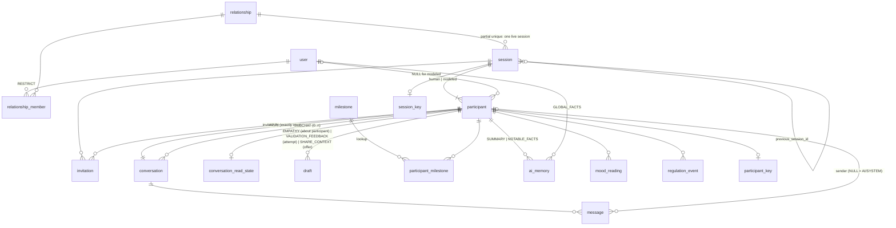
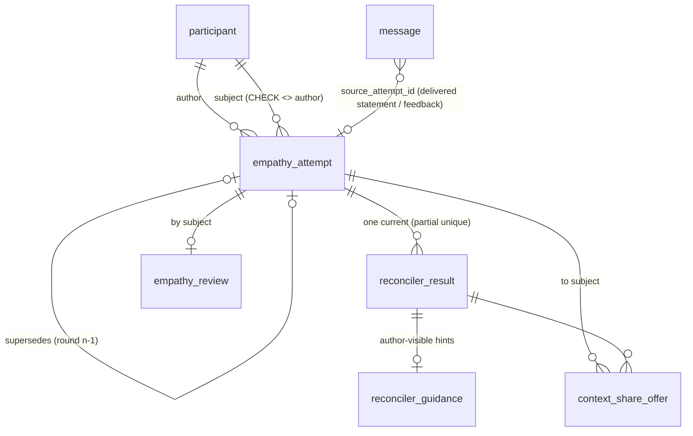
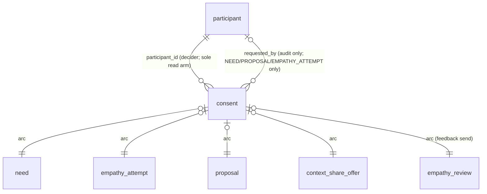
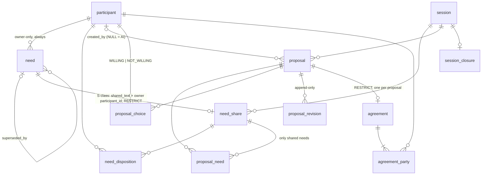
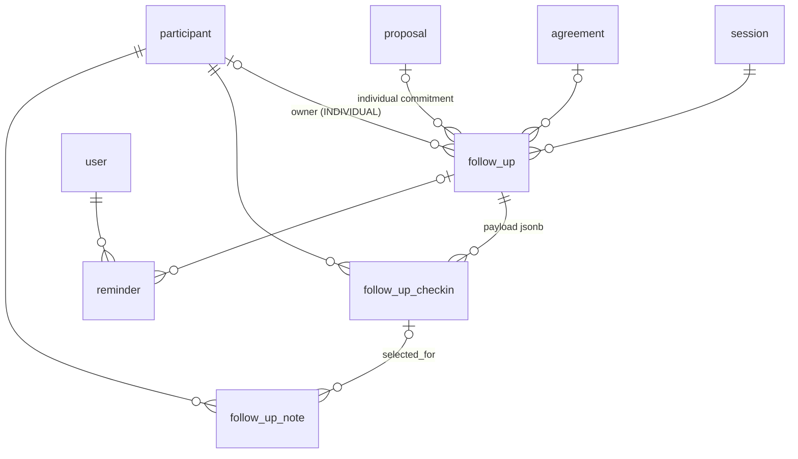
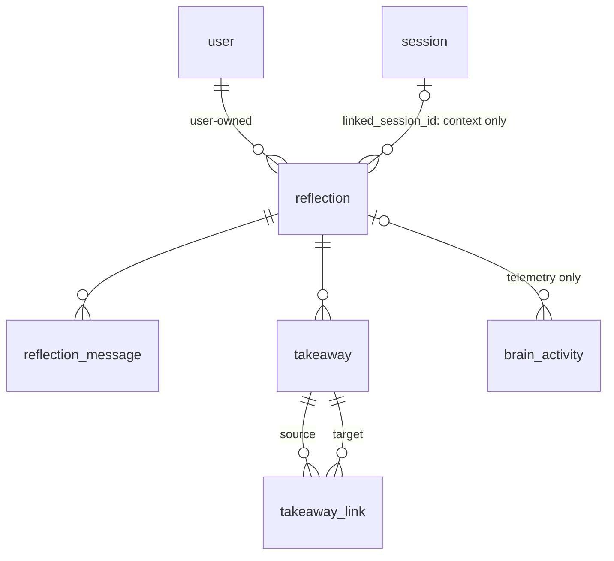
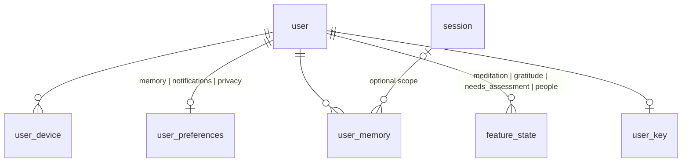
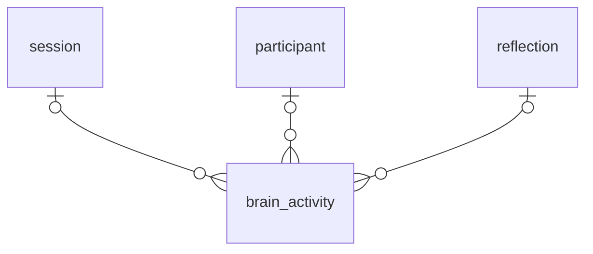

# Target Schema — October 2026

Companion to [`schema-review-2026-10.md`](./schema-review-2026-10.md) (the review and the owner
decisions D1–D4 of 2026-10-13 in its §9) and [`schema-migration-plan-2026-10.md`](./schema-migration-plan-2026-10.md)
(how to get there). Security predicates re-base [`phase3-design-summary.md`](./phase3-design-summary.md)
§2–§6; where a predicate is unchanged in spirit it is marked **(P3 §2)**.

## Assumptions, 2026-10-17

The review's Q3–Q7 are still open. The target is designed under these; each can be vetoed on its own.

| # | Assumption | Cheap to reverse? |
|---|---|---|
| A-Q3 | **One live (non-terminal) session per relationship**, enforced by `UNIQUE (relationship_id) WHERE status NOT IN ('RESOLVED','ABANDONED','ARCHIVED')` on `session` | **yes** — drop the partial index |
| A-Q4 | **Wellbeing features demoted to documents**: meditation, gratitude, needs assessment and people tracking each become one `feature_state(user_id, feature, doc jsonb, updated_at)` row per feature per user (the owner's own suggestion). The 19-row need taxonomy moves to a shared constant in code. `mood_reading` and `regulation_event` stay as session tables because they are part of the journey, not a satellite | **yes** — a feature is promoted back to tables by a migration that unpacks its document; nothing else references the documents |
| A-Q5 | **Empathy attempts are immutable per round**: one row per submission, `round` increments, reveal and review reference a specific row | **no** — reverting to in-place overwrite loses the history the product spec requires ("a later private edit must not silently change what the partner was shown") |
| A-Q6 | **Pre-session chat is dropped** (`PreSessionMessage` is never populated today) | **yes** — a `conversation` with `session_id NULL` and a `participant` whose session is `CREATED` can be added later; D1's status-gated cardinality already allows a one-participant session |
| A-Q7 | **snake_case identifiers now**, with Prisma `@map`/`@@map` on every field and model | **yes** (mechanical), but do it now: every policy, trigger, CHECK and view is hand-written SQL and would otherwise quote `"PascalCase"` forever |
| A-P1/P2 | Parked questions stay parked: the shape supports all-N or pairwise reveal (`v_session_readiness` vs per-attempt status) and gives a modeled participant a `conversation` row like any other; whether a human may read it is a policy, not a column | — |

## Conventions (apply to every table; not repeated below)

| Rule | Detail |
|---|---|
| Ids | `id uuid PRIMARY KEY DEFAULT uuidv7()`. Junctions use composite PKs |
| Timestamps | all `timestamptz`; `created_at timestamptz NOT NULL DEFAULT now()` on every table; `updated_at timestamptz NOT NULL DEFAULT now()` on tables updated in place, maintained by one `BEFORE UPDATE` trigger `app.touch_updated_at()`; append-only tables have no `updated_at` and `mwf_app` holds no `UPDATE` grant on them |
| Names | snake_case tables and columns; enums `snake_case` types; Prisma models PascalCase via `@@map`, fields camelCase via `@map` |
| FK delete rules | → `user`: **RESTRICT, always** (soft delete, P3 D9). → `session`: CASCADE (retention hard-deletes whole sessions). → `participant`: CASCADE (a participant row is removed only with its session; a leaver's row survives, pointing at the tombstone). → `conversation`, `reflection`, `empathy_attempt`, `follow_up`: CASCADE. → `need` from `need_share`: **RESTRICT** (a shared need is delivered content and survives its owner; N-3). → `consent`: nothing references it (P0-3) — a consent row is never deleted by `mwf_app` (no DELETE policy) and goes only with its target/session. → `proposal`: RESTRICT from `agreement`, CASCADE from its own children. → `milestone`: RESTRICT |
| Every FK | has a supporting index unless it is the leading column of the PK or of a listed unique |
| `jsonb` | every column carries `CHECK (jsonb_typeof(col) = 'object')` (or `'array'`); documents with a known contract add key-presence checks listed per table |
| Visibility classes | **P** private-to-participant · **S** shared-vessel (all participants of the session) · **U** user-private (outside any session) · **G** global/reference · **T** telemetry |
| Encryption keys (P3 D5, §8.6) | **user** key (`user_key`) for U-class content; **session** key (`session_key`) for S-class; **participant** key (`participant_key`, the review's refinement of "conversation_key") for P-class; **none** for G/T. **Writer-principal rule (per row, not per table):** anything written for the owner's own eyes is encrypted under that participant's key; anything *delivered to* or *readable by* a co-participant is written (or re-encrypted at the share moment) under the session key by the two-party job. The envelope `enc:v2:<keyId>` names the key per value, so no table needs a key column; the per-column key class below is the rule the writer must follow. Consequence: a conditional co-participant read arm is allowed only on a column that is session-keyed from the moment the arm can be true |
| RLS shorthand | `me` = `app.current_user_id()` (NULL when unset ⇒ zero rows, fail-closed). `mine(p)` = inline `EXISTS (SELECT 1 FROM participant p WHERE p.id = <col> AND p.user_id = me)` — a *self* check, safe to inline (P3 §2 "inline EXISTS for self-checks"). `member(s)` = `app.is_member(<session>)` and `co(p)` = `app.is_co_participant(<participant>)` — **`SECURITY DEFINER` helpers owned by `mwf_job`, identity-bound to `me`, never inline**: an inline `EXISTS … FROM participant` inside `participant`'s own policy, or inside any policy evaluated while `participant`'s policy is active, raises `infinite recursion detected in policy for relation "participant"` (adversarial P1-1 [V]; P3 §2 "helper functions only where the check is about the partner"). `job` = `current_user IN ('mwf_job','mwf_migrator')`. Four policies per table, `TO mwf_app`, never `ALL` (P3 §2). Columns a read policy trusts are pinned by the write policy and are not in the column `UPDATE` grant (P3 §4). **Column-level narrowing is not available per arm**: grants are per role and the owner reads through the same `mwf_app` role, so a row readable by a co-participant is readable in full — a column the partner must not see lives in a different table (adversarial P0-1; the same failure class as Phase 3's rejected `User_covisible` policy, P3 §2 `User` row) |

---

## 1. Tables by cluster

### 1.1 Core / session (16)

#### `relationship`
Durable pairing of users across sessions. · core · S · none
| column | type | null | default | meaning |
|---|---|---|---|---|
| id | uuid | no | uuidv7() | |
| created_at, updated_at | timestamptz | no | now() | |

Keys: PK. No cardinality rule (D1). FKs: none. Indexes: none.
RLS: S `EXISTS (relationship_member m WHERE m.relationship_id = id AND m.user_id = me)` (P3 §2 bespoke) · I `job` (created by the invitation path) · U none · D none.
Absorbs: `Relationship`.

#### `relationship_member`
A user's membership in a relationship (not in a session). · core · S · none
| column | type | null | default | meaning |
|---|---|---|---|---|
| relationship_id | uuid | no | | FK relationship CASCADE |
| user_id | uuid | no | | FK user RESTRICT |
| role | relationship_role | no | 'member' | `member \| owner` |
| nickname | text | yes | | what this member calls the other(s) |
| joined_at | timestamptz | no | now() | |
| created_at, updated_at | timestamptz | no | now() | |

Keys: PK (relationship_id, user_id). Index (user_id) — "my relationships". CHECK via enum.
RLS: S `user_id = me OR EXISTS (relationship_member m2 WHERE m2.relationship_id = relationship_id AND m2.user_id = me)` · I `job` · U `user_id = me` (nickname only, column grant) · D none.
Absorbs: `RelationshipMember` (drops surrogate `id`; `role` text → enum).

#### `session`
One facilitated process on one topic between the participants. · core · S · session (topic_frame)
| column | type | null | default | meaning |
|---|---|---|---|---|
| id | uuid | no | uuidv7() | |
| relationship_id | uuid | no | | FK relationship CASCADE |
| status | session_status | no | 'CREATED' | `CREATED, INVITED, ACTIVE, RESOLVED, ABANDONED, ARCHIVED` |
| topic_frame | text | yes | | 3–5 word neutral topic (encrypted) |
| topic_frame_confirmed_at | timestamptz | yes | | |
| previous_session_id | uuid | yes | | FK session SET NULL — lineage from a NEW_PROCESS follow-up |
| resolved_at | timestamptz | yes | | |
| created_at, updated_at | timestamptz | no | now() | |

Keys: PK. **Partial unique (A-Q3)** `UNIQUE (relationship_id) WHERE status NOT IN ('RESOLVED','ABANDONED','ARCHIVED')`. CHECK `status <> 'RESOLVED' OR resolved_at IS NOT NULL` (one direction only: `RESOLVED → ARCHIVED` keeps `resolved_at`; the product archives resolved sessions, `invitations.ts:1019`). Indexes: (relationship_id), (previous_session_id). Transitions (enforced by `app.session_set_status`): `CREATED→INVITED→ACTIVE`, `CREATED|INVITED|ACTIVE→ABANDONED`, `ACTIVE→RESOLVED`, `RESOLVED|ABANDONED→ARCHIVED`; nothing leaves `ARCHIVED`. Trigger **T-cardinality-1**: `BEFORE UPDATE OF status` refuses `→ ACTIVE` unless `≥2 participant` rows exist with `≥1 kind='human' AND left_at IS NULL` (D1).
RLS: S `member(id)` (P3 §2 shape E) · I `job`/invitation path · U `member(id)` for `status`, `topic_frame*` only; status transitions through `app.session_set_status()` · D `job` (retention).
Absorbs: `Session` minus `type` (dropped; `INNER_WORK` never written), minus `WAITING`/`PAUSED` (per-participant states → milestones), minus `SharedVessel` (1:1 container with no columns — its children now key on `session_id`).

#### `participant`
One membership of a session: the first-class entity (D1). · core · S (existence) / P (its content) · none
| column | type | null | default | meaning |
|---|---|---|---|---|
| id | uuid | no | uuidv7() | |
| session_id | uuid | no | | FK session CASCADE |
| user_id | uuid | yes | | FK user RESTRICT; NULL for a modeled participant |
| kind | participant_kind | no | 'human' | `human \| modeled` |
| display_name | text | yes | | snapshot of the name shown to co-participants; the only `user` fact a co-participant may see (P3 §2 `partner_display_name`) |
| joined_at | timestamptz | no | now() | |
| left_at | timestamptz | yes | | set when the user leaves/deletes; row stays |
| created_at, updated_at | timestamptz | no | now() | |

Keys: PK. UNIQUE (session_id, user_id) — a user is one participant per session. CHECK `(kind = 'modeled') = (user_id IS NULL)`. Indexes: (user_id) — "my sessions". Trigger **T-cardinality-2**: `DEFERRABLE INITIALLY DEFERRED` constraint trigger on DELETE / UPDATE OF kind, user_id, **left_at** refusing to leave a non-terminal session with no human participant whose `left_at IS NULL` (D1). `left_at` semantics: it does **not** affect `app.is_member` — a leaver who has not deleted their account keeps reading the shared vessel (today's behaviour); the tombstone path sets `left_at` *and* moves the live session to `ABANDONED`, and the tombstoned `user_id` never equals any `me`, so access ends through identity, not through this column.
RLS: S `user_id = me OR app.is_member(session_id)` (definer helper — an inline `EXISTS` here recurses, P1-1). Co-participants read the whole row: `id, kind, display_name, joined_at, left_at` **and `user_id`** — a column arm cannot hide it (Conventions), and `relationship_member` already exposes it; `display_name` is the only *user* fact exposed, and `v_participant` masks everything else · I `job` (invitation accept / session create) · U `user_id = me` (display_name only) · D none.
Absorbs: new. Seeded from `StageProgress(sessionId,userId)` ∪ `UserVessel(sessionId,userId)` ∪ `RelationshipMember × Session`; `display_name` from `User.name`/`RelationshipMember.nickname`.

#### `conversation`
A participant's private thread with their AI guide inside a session; also a Stage-4 sub-chat. · core · P · participant
| column | type | null | default | meaning |
|---|---|---|---|---|
| id | uuid | no | uuidv7() | |
| participant_id | uuid | no | | FK participant CASCADE |
| kind | conversation_kind | no | 'MAIN' | `MAIN \| SUBCHAT` |
| anchor_kind | subchat_anchor | yes | | `NEEDS_BRAINSTORM \| PROPOSAL_REFINEMENT \| NO_OVERLAP` (SUBCHAT only) |
| anchor_proposal_id | uuid | yes | | FK proposal SET NULL (SUBCHAT only) |
| status | conversation_status | no | 'ACTIVE' | `ACTIVE \| RESOLVED` |
| resolved_at | timestamptz | yes | | |
| created_at, updated_at | timestamptz | no | now() | |

Keys: PK. **Partial unique** `UNIQUE (participant_id) WHERE kind = 'MAIN'` — exactly one main thread per participant. CHECK `(kind = 'MAIN') = (anchor_kind IS NULL)`. Indexes: (participant_id, kind, status) — sub-chat lookup; (anchor_proposal_id).
RLS: S `mine(participant_id)` · I `mine(participant_id)` (pins participant_id) · U `mine(participant_id)` (status, resolved_at) · D none.
Absorbs: `UserVessel` (identity and `archivedAt` → `conversation_read_state`), `Stage4SubChat`. The three `UserVessel` children production never creates — `UserEvent`, `Boundary`, `UserDocument` (census §2.2) — are dropped with it; nothing absorbs them.

#### `conversation_read_state`
Hot per-participant view state. · core · P · none (timestamps and an id only)
| column | type | null | default | meaning |
|---|---|---|---|---|
| participant_id | uuid | no | | PK, FK participant CASCADE |
| last_viewed_at | timestamptz | yes | | chat tab |
| last_seen_message_id | uuid | yes | | FK message SET NULL — "new messages" line |
| last_viewed_share_tab_at | timestamptz | yes | | |
| last_active_at | timestamptz | yes | | presence (subject to privacy prefs) |
| archived_at | timestamptz | yes | | hidden from this participant's list |
| updated_at | timestamptz | no | now() | |

Keys: PK (participant_id). Index (last_seen_message_id).
RLS: S `mine(participant_id)`; `last_active_at` is read for the partner through `v_participant` only when `user_preferences.doc->'privacy'->>'showActivityStatus'` allows — a view, not a policy · I/U `mine(participant_id)` · D none.
Absorbs: `UserVessel.{lastViewedAt, lastSeenChatItemId, lastViewedShareTabAt, lastActiveAt, archivedAt}`.

#### `message`
One line of a conversation: human, AI, system, or a delivered cross-participant item. · core · P · **per row** — the owner's own turns and the AI's replies to them: participant key; rows written for the partner, or by the job for both parties (every delivered `kind`): session key (Conventions writer-principal rule; detail under "Key per row" below)
| column | type | null | default | meaning |
|---|---|---|---|---|
| id | uuid | no | uuidv7() | |
| conversation_id | uuid | no | | FK conversation CASCADE — the audience |
| sender_participant_id | uuid | yes | | FK participant CASCADE; NULL for AI/SYSTEM |
| role | message_role | no | | `USER \| AI \| SYSTEM` |
| kind | message_kind | no | 'CHAT' | `CHAT, EMPATHY_STATEMENT, EMPATHY_REVEAL_INTRO, SHARED_CONTEXT, VALIDATION_FEEDBACK, SHARE_SUGGESTION, EMPATHY_VALIDATION_PROMPT` |
| content | text | no | | encrypted |
| content_hash | varchar(64) | yes | | SHA-256 of plaintext (dedupe probes) |
| refining_need_id | uuid | yes | | FK need SET NULL |
| source_attempt_id | uuid | yes | | FK empathy_attempt SET NULL — which attempt row a delivered `EMPATHY_STATEMENT` / `VALIDATION_FEEDBACK` / `SHARED_CONTEXT` came from (lineage). **The reveal job writes the `EMPATHY_STATEMENT` row into the subject's conversation** (today it is written only into the author's own chat, `stage2.ts:737`, `:2114`); the author keeps their own copy too |
| created_at | timestamptz | no | now() | |

Keys: PK. CHECK `role <> 'USER' OR sender_participant_id IS NOT NULL`; CHECK `role NOT IN ('AI','SYSTEM') OR sender_participant_id IS NULL` (P3 §6, "humans can't author as the facilitator"). Indexes: (conversation_id, created_at) — the chat list; (conversation_id, kind, content_hash) — dedupe probes; (sender_participant_id); (refining_need_id); (source_attempt_id). Append-only: no `updated_at`; trigger **T-message-immutable** `BEFORE UPDATE` refuses changes to `conversation_id, sender_participant_id, role, kind`, and to `content` when `role IN ('AI','SYSTEM') OR kind <> 'CHAT'` (delivered items are role USER and must be immutable too — adversarial P2); `mwf_job` is exempt only for the W13 re-encryption backfill (P3 §4 exemption arm).
**Key per row:** `role = USER, kind = CHAT` written by the owner's turn → participant key; AI/SYSTEM replies to the owner → participant key; every delivered kind (`EMPATHY_STATEMENT` in the subject's conversation, `SHARED_CONTEXT`, `VALIDATION_FEEDBACK`, `SHARE_SUGGESTION`, `EMPATHY_REVEAL_INTRO`, `EMPATHY_VALIDATION_PROMPT`) is written by `mwf_job` under the **session** key (P3 §8.6 two-party path), so the recipient can decrypt it and the author's shred does not destroy what was delivered (D9).
RLS: S `EXISTS (conversation c JOIN participant p ON p.id = c.participant_id WHERE c.id = conversation_id AND p.user_id = me) OR mine(sender_participant_id)` (P3 §2 bespoke `Message`, re-based) · I same, with `sender_participant_id` pinned to me for role USER; AI/SYSTEM rows and all delivered kinds inserted by `mwf_job` · U none for `mwf_app` · D none.
Absorbs: `Message` (`sessionId`+`forUserId` → `conversation_id`; `senderId` → participant; `role` split; `stage` dropped — derivable from `participant_milestone`; `extractedNeeds/Emotions` dropped), `Stage4SubChatMessage`. **Not** `InnerWorkMessage` (→ `reflection_message`).

#### `draft`
A participant's working text for a sharing point, before any consent. · core · P · participant
| column | type | null | default | meaning |
|---|---|---|---|---|
| id | uuid | no | uuidv7() | |
| participant_id | uuid | no | | FK participant CASCADE |
| kind | draft_kind | no | | `EMPATHY \| VALIDATION_FEEDBACK \| SHARE_CONTEXT` |
| about_participant_id | uuid | yes | | FK participant CASCADE — EMPATHY: the subject being imagined |
| attempt_id | uuid | yes | | FK empathy_attempt CASCADE — VALIDATION_FEEDBACK: the attempt reviewed |
| share_offer_id | uuid | yes | | FK context_share_offer CASCADE — SHARE_CONTEXT: the offer being edited |
| content | text | no | | encrypted (participant key) |
| ready_to_share | boolean | no | false | |
| version | int | no | 1 | |
| created_at, updated_at | timestamptz | no | now() | |

Keys: PK. CHECK `num_nonnulls(about_participant_id, attempt_id, share_offer_id) = 1` and the arm matches `kind`. **Unique** `(participant_id, kind, coalesce(about_participant_id, attempt_id, share_offer_id))` — one draft per sharing point, so N subjects / N attempts do not collide (adversarial P1-5). Indexes: the three arc columns.
RLS: S/I/U `mine(participant_id)` · D `mine(participant_id)`.
Absorbs: `EmpathyDraft` (about = the other participant), `ValidationFeedbackDraft` (attempt = the reviewed attempt), `ReconcilerShareOffer.refinedContent` (the subject's edit of a share suggestion).

#### `milestone`
Lookup of journey milestones; the only place "stage" exists, as data. · core · G · none
| column | type | null | default | meaning |
|---|---|---|---|---|
| key | text | no | | PK, e.g. `compact_signed`, `invitation_sent`, `feel_heard`, `empathy_submitted`, `empathy_ready`, `empathy_validated`, `needs_confirmed`, `needs_shared`, `choices_shared`, `closed` |
| ordinal | int | no | | order along the journey |
| stage_label | text | no | | UI label of the stage this milestone belongs to ("Your Story", …) |
| scope | milestone_scope | no | 'participant' | `participant \| session` — whether all participants must reach it for the session to advance |
| self_assertable | boolean | no | false | may the participant insert it themselves (a CTA), or only `mwf_job` (a system fact) |
| created_at | timestamptz | no | now() | |

Keys: PK (key). UNIQUE (ordinal). Seeded by migration from today's gate keys; renumbering is an `UPDATE`.
RLS: no RLS (reference table); `GRANT SELECT` to `mwf_app` (P3 §1.1 pattern, like `Need`).
Absorbs: the key set of `StageProgress.gatesSatisfied` and the `stage` integers (D3).

#### `participant_milestone`
Event: a participant reached a milestone at a time. · core · S (progress is visible to co-participants per the visibility table) · none
| column | type | null | default | meaning |
|---|---|---|---|---|
| participant_id | uuid | no | | FK participant CASCADE |
| milestone_key | text | no | | FK milestone RESTRICT |
| reached_at | timestamptz | no | now() | |

Keys: PK (participant_id, milestone_key). Index (milestone_key, reached_at) — readiness scans. Append-only (no `updated_at`; un-reaching a milestone is a `DELETE` by `mwf_job` only — "withdraw selections" path). **No payload column**: an S-class `jsonb` would carry private material (the old `finalEmotionalReading` gate) to co-participants; a gate's payload lives on the P-class table it belongs to (`mood_reading`) (adversarial P1-2).
RLS: S `mine(participant_id) OR co(participant_id)` · I `mine(participant_id)` **only for keys with `milestone.self_assertable = true`** (`compact_signed`, `feel_heard`, `needs_confirmed`, `choices_shared`); every key that records a fact the system establishes (`invitation_sent`, `empathy_submitted`, `empathy_ready`, `empathy_validated`, `needs_shared`, `closed`, `paused`) is inserted by `mwf_job` (adversarial P2 — otherwise a participant can self-insert `empathy_validated`) · U none · D `job`.
Absorbs: `StageProgress` rows + the boolean/timestamp pairs in `gatesSatisfied` per the key table in the migration plan §3 step 7; `Session.status WAITING/PAUSED`.

#### `ai_memory`
AI working memory: rolling summary, notable facts, consolidated global facts. · core · P (participant scope) / U (user scope) · participant / user
| column | type | null | default | meaning |
|---|---|---|---|---|
| id | uuid | no | uuidv7() | |
| participant_id | uuid | yes | | FK participant CASCADE |
| user_id | uuid | yes | | FK user RESTRICT |
| kind | ai_memory_kind | no | | `SUMMARY \| NOTABLE_FACTS \| GLOBAL_FACTS` |
| doc | jsonb | no | | encrypted; `CHECK jsonb_typeof = 'object'`; `SUMMARY` requires keys `text, messageCount, generatedAt`; `*_FACTS` requires `facts` array |
| created_at, updated_at | timestamptz | no | now() | |

Keys: PK. CHECK `num_nonnulls(participant_id, user_id) = 1`; CHECK `(kind = 'GLOBAL_FACTS') = (user_id IS NOT NULL)`. UNIQUE (participant_id, kind) WHERE participant_id IS NOT NULL; UNIQUE (user_id, kind) WHERE user_id IS NOT NULL.
RLS: S/I/U `mine(participant_id) OR user_id = me`; in practice written by `mwf_job` (background classifiers) · D `job`.
Absorbs: `UserVessel.conversationSummary` (text JSON → jsonb), `UserVessel.notableFacts`, `User.globalFacts` (comment says array, code writes object — the object shape wins), `InnerWorkSession.conversationSummary` moves to `reflection.summary_doc` instead (never mixed).

#### `mood_reading`
Barometer reading (1–10) by a participant. · core · P · none (integer + short context, encrypted context)
| column | type | null | default | meaning |
|---|---|---|---|---|
| id | uuid | no | uuidv7() | |
| participant_id | uuid | no | | FK participant CASCADE |
| intensity | intensity | no | | domain `int CHECK 1..10` |
| context | text | yes | | encrypted |
| recorded_at | timestamptz | no | now() | |

Keys: PK. Index (participant_id, recorded_at) — time series. Append-only.
RLS: S/I `mine(participant_id)` · U/D none.
Absorbs: `EmotionalReading` (drops `stage`); `User.lastMoodIntensity` becomes `v_participant.last_mood` (latest reading across the user's participants).

#### `regulation_event`
A completed emotional-regulation exercise. · core · P · none
| column | type | null | default | meaning |
|---|---|---|---|---|
| id | uuid | no | uuidv7() | |
| participant_id | uuid | no | | FK participant CASCADE |
| type | regulation_type | no | | `BREATHING_EXERCISE \| BODY_SCAN \| GROUNDING \| PAUSE_SESSION` |
| intensity_before, intensity_after | intensity | yes | | |
| completed_at | timestamptz | no | now() | |

Keys: PK. Index (participant_id, completed_at). Append-only.
RLS: S/I `mine(participant_id)` · U/D none.
Absorbs: `EmotionalExerciseCompletion`.

#### `invitation`
An invitation to join a session. · core · S · session (name)
| column | type | null | default | meaning |
|---|---|---|---|---|
| id | uuid | no | uuidv7() | |
| session_id | uuid | no | | FK session CASCADE |
| invited_by_participant_id | uuid | no | | FK participant CASCADE |
| accepted_by_user_id | uuid | yes | | FK user RESTRICT (P3 §6 new column) |
| name | text | yes | | invitee display name (encrypted) |
| status | invitation_status | no | 'PENDING' | `PENDING \| ACCEPTED \| DECLINED \| EXPIRED` |
| message_confirmed_at | timestamptz | yes | | |
| expires_at | timestamptz | no | | |
| accepted_at, declined_at | timestamptz | yes | | |
| decline_reason | text | yes | | |
| created_at, updated_at | timestamptz | no | now() | |

Keys: PK. CHECK `status <> 'ACCEPTED' OR (accepted_at IS NOT NULL AND accepted_by_user_id IS NOT NULL)` (P3 §6). Indexes: (session_id), (status, expires_at) — expiry sweep, (accepted_by_user_id).
RLS: S `mine(invited_by_participant_id) OR accepted_by_user_id = me OR member(session_id)` (P3 §2 bespoke `Invitation`) · I `mine(invited_by_participant_id)` · U inviter (message_confirmed) or `mwf_job` (accept/decline/expire) · D none.
Absorbs: `Invitation` (`messageConfirmed` boolean folded into the timestamp; `invitedById` → participant).

#### `session_key`, `participant_key`
Envelope keys (P3 D5). · core · — · (they *are* keys)
| column | type | null | default | meaning |
|---|---|---|---|---|
| id | uuid | no | uuidv7() | |
| session_id / participant_id | uuid | no | | FK CASCADE; UNIQUE WHERE destroyed_at IS NULL |
| key_id | text | no | | KMS key id |
| wrapped_dek | bytea | no | | |
| created_at | timestamptz | no | now() | |
| destroyed_at | timestamptz | yes | | the crypto-shred |

RLS: S `member(session_id)` / `mine(participant_id)`; I once by the creating path; U none for `mwf_app` (`destroyed_at` is `mwf_job`'s) (P3 cat §1.2). Absorbs: new. `user_key` is in §1.7.

### 1.2 Empathy and reconciler (5)

#### `empathy_attempt`
A submitted statement by `author` about `subject`, immutable per round (A-Q5). · empathy · P until revealed, then S between author and subject · participant (author) until reveal; **re-encrypted under the session key by the reveal job** (so `content` is updated exactly once, by `mwf_job`, with the same plaintext — the immutability trigger exempts that principal)
| column | type | null | default | meaning |
|---|---|---|---|---|
| id | uuid | no | uuidv7() | |
| author_participant_id | uuid | no | | FK participant CASCADE |
| subject_participant_id | uuid | no | | FK participant CASCADE |
| round | int | no | 1 | increments per resubmission in the same direction |
| supersedes_attempt_id | uuid | yes | | FK empathy_attempt SET NULL — the previous round |
| content | text | no | | encrypted; plaintext never changes |
| status | empathy_status | no | 'HELD' | `HELD, AWAITING_SHARING, REFINING, READY, REVEALED, VALIDATED, SUPERSEDED` (legacy `ANALYZING`, `NEEDS_WORK` dropped) |
| status_version | int | no | 0 | event ordering |
| submitted_at | timestamptz | no | now() | |
| revealed_at | timestamptz | yes | | **set once, never cleared** — the subject's read right hangs on it, not on `status` |
| delivery_status | delivery_status | no | 'PENDING' | `PENDING \| DELIVERED \| SEEN` |
| delivered_at, seen_at | timestamptz | yes | | |
| created_at, updated_at | timestamptz | no | now() | |

Keys: PK. UNIQUE (author_participant_id, subject_participant_id, round). **Partial unique** `UNIQUE (author_participant_id, subject_participant_id) WHERE status NOT IN ('SUPERSEDED','VALIDATED')` — one live attempt per direction; resubmission sets round n to `SUPERSEDED` and inserts n+1 in one `app.empathy_set_status`-mediated transaction. CHECK `author_participant_id <> subject_participant_id` (D1; replaces P3's `guesserId <> subjectId`); CHECK `status IN ('REVEALED','VALIDATED') → revealed_at IS NOT NULL`. Trigger **T-same-session**: author and subject belong to the same session. The submission consent is the `consent` row whose arc names this attempt (`consent.empathy_attempt_id`); **no back-pointer** — a `consent_id` here with the arc's CASCADE forms an insert cycle that needs an `UPDATE` grant `mwf_app` does not have (adversarial P0-3). Indexes: (subject_participant_id, revealed_at) — "what is revealed to me"; (supersedes_attempt_id).

Transition table (`empathy-state-machine.ts:14–69`, with `SUPERSEDED` added; `app.empathy_set_status` is its only executor and refuses anything else):

| from | to | event / actor |
|---|---|---|
| HELD | AWAITING_SHARING, READY | reconciler (`mwf_job`) |
| AWAITING_SHARING | REFINING (subject shared context), READY (subject declined) | `mwf_job` |
| REFINING | READY, AWAITING_SHARING (re-analysis) | `mwf_job` |
| READY | REVEALED | `mwf_job`, **only when the reveal gate holds** (every direction of the session is READY or later — the all-N gate lives in the function; pairwise is a one-line change there if P1 is decided that way) |
| REVEALED | VALIDATED (subject), REFINING (subject sent feedback) | subject via function |
| any except VALIDATED | SUPERSEDED | author resubmits (function inserts round n+1 in the same transaction) |

RLS: S `mine(author_participant_id) OR (mine(subject_participant_id) AND revealed_at IS NOT NULL)` — status-independent, so a `SUPERSEDED` round the subject already read stays readable (adversarial P0-2; P3 §2 bespoke `EmpathyAttempt`, narrower than "any member") · I `mine(author_participant_id)` pinned · U **none for `mwf_app`**: `status` only through `app.empathy_set_status(id, status)` (P3 §5), `delivery_status`/`seen_at`/re-encrypted `content` through `mwf_job` · D none. **Status visibility for the waiting UI** (`partnerEmpathyHeldStatus`, `empathy-status.ts:264`): the subject may not read an unrevealed row, so the status comes from `v_empathy_direction_status` (§4), a content-free projection served by a definer function to both parties of the direction.
Absorbs: `EmpathyAttempt` (`sourceUserId` → author; subject made explicit; `draftId` dropped; `revisionCount` → rows; `consentRecordId` dropped — never written), `RefinementAttemptCounter` (count of rounds).

#### `empathy_review`
The subject's verdict on a revealed attempt. · empathy · S between the two once sent · **session** key (the row exists to be delivered; the unsent coached text is a `draft(VALIDATION_FEEDBACK)` under the participant key — adversarial P1-3)
| column | type | null | default | meaning |
|---|---|---|---|---|
| id | uuid | no | uuidv7() | |
| attempt_id | uuid | no | | FK empathy_attempt CASCADE |
| reviewer_participant_id | uuid | no | | FK participant CASCADE (= the attempt's subject; trigger-checked) |
| validated | boolean | no | | |
| feedback | text | yes | | encrypted (session key); present only once sent |
| feedback_sent_at | timestamptz | yes | | explicit send (visibility table: "delivered after explicit send") |
| created_at, updated_at | timestamptz | no | now() | |

Keys: PK. UNIQUE (attempt_id, reviewer_participant_id). CHECK `feedback IS NULL OR feedback_sent_at IS NOT NULL`. Index (reviewer_participant_id). The send consent is the `consent` row with `review_id` (arc); no back-pointer.
RLS: S `mine(reviewer_participant_id) OR (feedback_sent_at IS NOT NULL AND EXISTS (empathy_attempt a WHERE a.id = attempt_id AND mine(a.author_participant_id)))`; before send the author sees nothing (the `validated` flag included) · I/U `mine(reviewer_participant_id)` · D none.
Absorbs: `EmpathyValidation` (`feedbackShared` → timestamp; unsent `feedback` text → `draft`).

#### `reconciler_result`
Gap analysis for one attempt; immutable; one current per attempt. · empathy · P to the **subject** only (P3 D8a) · participant (subject)
| column | type | null | default | meaning |
|---|---|---|---|---|
| id | uuid | no | uuidv7() | |
| attempt_id | uuid | no | | FK empathy_attempt CASCADE |
| subject_participant_id | uuid | no | | FK participant CASCADE (denormalised for the policy; trigger-checked = attempt.subject) |
| iteration | int | no | 1 | |
| alignment_score | int | no | | CHECK 0..100 |
| alignment_summary, gap_summary | text | no | | encrypted |
| gap_severity | gap_severity | no | | `NONE \| MINOR \| MODERATE \| SIGNIFICANT` (was lowercase free text) |
| correctly_identified, missed_feelings, misattributions | text[] | no | '{}' | LLM output, encrypted-as-json if the map requires |
| most_important_gap | text | yes | | |
| recommended_action | recommender_action | no | | `PROCEED \| OFFER_OPTIONAL \| OFFER_SHARING` |
| rationale | text | no | | |
| sharing_would_help | boolean | no | | |
| suggested_share_focus, suggested_share_content, suggested_share_reason | text | yes | | the subject's private suggestion |
| circuit_breaker_tripped | boolean | no | false | (kept; was never read — read it in `v_empathy_direction` or drop at implementation) |
| superseded_at | timestamptz | yes | | |
| created_at | timestamptz | no | now() | |

Keys: PK. **Partial unique** `UNIQUE (attempt_id) WHERE superseded_at IS NULL`. UNIQUE (attempt_id, iteration). Index (subject_participant_id). Append-only except `superseded_at` (`mwf_job`). Trigger **T-result-live-attempt**: refuse INSERT when the attempt's `status = 'SUPERSEDED'` and when `subject_participant_id <> attempt.subject_participant_id` — a late result cannot land on a retired round (adversarial P2; was a service rule).
RLS: S `mine(subject_participant_id)` **only** (P3 §2) · I/U `job` · D none.
Absorbs: `ReconcilerResult` minus `guesserName/subjectName`, minus the three guidance columns.

#### `reconciler_guidance`
The abstract hints the **author** may see (P3 D8a split). · empathy · P to author (and subject) · participant (author)
| column | type | null | default | meaning |
|---|---|---|---|---|
| result_id | uuid | no | | PK, FK reconciler_result CASCADE |
| author_participant_id, subject_participant_id | uuid | no | | FK participant CASCADE (policy columns) |
| area_hint, guidance_type, prompt_seed | text | yes | | no partner content by construction |
| created_at | timestamptz | no | now() | |

RLS: S `mine(author_participant_id) OR mine(subject_participant_id)` (P3 §2) · I `job` · U/D none.
Absorbs: `ReconcilerResult.{areaHint, guidanceType, promptSeed}`.

#### `context_share_offer`
The suggestion to the subject to share context, and what happened to it. · empathy · P to subject; the shared text is delivered as a `message` to the author · participant (subject)
| column | type | null | default | meaning |
|---|---|---|---|---|
| id | uuid | no | uuidv7() | |
| attempt_id | uuid | no | | FK empathy_attempt CASCADE |
| result_id | uuid | no | | FK reconciler_result CASCADE |
| subject_participant_id | uuid | no | | FK participant CASCADE |
| iteration | int | no | 1 | |
| status | share_offer_status | no | 'PENDING' | `PENDING \| OFFERED \| ACCEPTED \| DECLINED \| EXPIRED` (legacy `NOT_OFFERED`, `SKIPPED` dropped) |
| offer_message, suggested_content, suggested_reason | text | yes | | encrypted |
| shared_content | text | yes | | the exact approved text (encrypted); also copied into the author's `message` (kind SHARED_CONTEXT) at delivery |
| shared_at, declined_at, offered_at | timestamptz | yes | | |
| delivery_status | delivery_status | no | 'PENDING' | |
| delivered_at, seen_at | timestamptz | yes | | |
| delivery_notified_at, seen_notified_at | timestamptz | yes | | **written** by the notification path (review F4.2 fix) |
| created_at, updated_at | timestamptz | no | now() | |

Keys: PK. UNIQUE (attempt_id, iteration). CHECK `(status = 'ACCEPTED') = (shared_at IS NOT NULL)`; `(status = 'DECLINED') = (declined_at IS NOT NULL)`. Indexes: (subject_participant_id, status) — pending-actions badge; (result_id). The share decision is the `consent` row with `share_offer_id` (arc); no back-pointer (P0-3). `shared_content` is session-keyed (delivered); `suggested_*`/`offer_message` participant-keyed (subject's private).
RLS: S `mine(subject_participant_id)` · I `job` · U `mine(subject_participant_id)` for the response columns (status via function), `mwf_job` for delivery/notification columns · D none.
Absorbs: `ReconcilerShareOffer` minus `skippedAt`, `refinementChatUsed`; `refinedContent` → `draft(kind SHARE_CONTEXT)`.

### 1.3 Consent (1)

#### `consent`
One explicit decision by a participant to let something cross a boundary. · consent · P to the decider; the *fact* of a GRANTED consent is implied to the recipient by the delivered artefact, never by this row · session
| column | type | null | default | meaning |
|---|---|---|---|---|
| id | uuid | no | uuidv7() | |
| participant_id | uuid | no | | FK participant CASCADE — who decides |
| requested_by_participant_id | uuid | yes | | FK participant CASCADE — who asked (recorded for audit; grants **no** read right) |
| need_id | uuid | yes | | FK need CASCADE |
| empathy_attempt_id | uuid | yes | | FK empathy_attempt CASCADE |
| proposal_id | uuid | yes | | FK proposal CASCADE |
| share_offer_id | uuid | yes | | FK context_share_offer CASCADE |
| review_id | uuid | yes | | FK empathy_review CASCADE (feedback send) |
| target_kind | consent_target | no | *generated* | `GENERATED ALWAYS AS (CASE WHEN need_id IS NOT NULL THEN 'NEED'::consent_target … END) STORED` — Prisma declares the exact `pg_get_expr` text (§5) |
| decision | consent_decision | yes | | `GRANTED \| DENIED \| REVOKED` |
| decided_at, revoked_at | timestamptz | yes | | |
| created_at | timestamptz | no | now() | |

Keys: PK. **Exclusive arc** `CHECK (num_nonnulls(need_id, empathy_attempt_id, proposal_id, share_offer_id, review_id) = 1)`. CHECK `(decision IS NULL) = (decided_at IS NULL)` (P3 §6); `revoked_at IS NULL OR decision = 'REVOKED'`; `requested_by_participant_id IS NULL OR target_kind IN ('NEED','PROPOSAL','EMPATHY_ATTEMPT')` — a share-offer or feedback consent has no requester, so a `DENIED` decision can never be read by the author (adversarial P1-4: "declining does not disclose"). Trigger **T-consent-owner** (BEFORE INSERT/UPDATE, **invoker rights, not `SECURITY DEFINER`**): the decider owns the arc target (NEED → `need.participant_id`; EMPATHY_ATTEMPT → author; PROPOSAL → creator; SHARE_OFFER → subject; REVIEW → reviewer). Run under the caller's RLS the partner's row is invisible, so a foreign target and a nonexistent target both resolve to no owner and are rejected with **one fixed message, `consent target is not yours`, carrying no ids** — the error text is not an existence oracle (adversarial pass 2 N-4; P3 §7 strips only `detail`). Trigger **T-consent-transitions**: `decision` moves only `NULL→GRANTED|DENIED`, `GRANTED→REVOKED`. Indexes: one per arc column; (participant_id, decided_at). **No table carries a `consent_id` back-pointer** (P0-3): the arc is the only link; the arc FKs cascade from the target side, so a consent row goes only with its target or session, and `mwf_app` has no DELETE policy on it.
RLS: S `mine(participant_id)` **only** (P3 §2 bespoke `ConsentRecord` had a requester arm; it is dropped — nothing in the product needs the requester to read the decision row, and the recipient learns of a GRANT from the delivered artefact) · I `mine(participant_id)` · U `mine(participant_id)` (decision columns only, via the trigger) · D none.
Absorbs: `ConsentRecord` (polymorphic `targetType/targetId` → arc; `metadata` dropped — never written), `ConsentedContent.{consentActive, revokedAt}` (the content → `need_share`).

### 1.4 Needs, proposals, agreements, closure (10)

#### `need`
A need identified for a participant — **owner-only, always**. · needs · P · participant
| column | type | null | default | meaning |
|---|---|---|---|---|
| id | uuid | no | uuidv7() | |
| participant_id | uuid | no | | FK participant CASCADE |
| label | text | no | | from the universal needs taxonomy (encrypted) |
| category | need_category | no | | `SAFETY, CONNECTION, AUTONOMY, RECOGNITION, MEANING, FAIRNESS` |
| evidence | text[] | no | '{}' | quotes (encrypted) |
| ai_confidence | real | no | | CHECK 0..1 |
| confirmed_at | timestamptz | yes | | user confirmed |
| locked_at | timestamptz | yes | | |
| superseded_by_need_id | uuid | yes | | FK need SET NULL |
| deleted_at | timestamptz | yes | | soft-delete inside the UI |
| created_at, updated_at | timestamptz | no | now() | |

Keys: PK. Indexes: (participant_id) WHERE deleted_at IS NULL; (superseded_by_need_id).
RLS: S/I/U `mine(participant_id)` · D none. **No co-participant arm.** The first draft merged `ConsentedContent` into this table with a co-participant arm plus a column grant to hide `label`/`evidence`/`ai_confidence`; that cannot work — grants are per role, the owner reads those columns through the same `mwf_app` role, so either the partner reads them off the base table or a `security_invoker` view returns zero rows to the partner and Stage 3 reveal cannot complete (adversarial P0-1 [V]; the same failure class as Phase 3's rejected `User_covisible` policy, P3 §2). The shared version is a separate S-class row:
Absorbs: `IdentifiedNeed`.

#### `need_share`
The transformed, consented version of a need that co-participants may see (the shared-vessel row). Reads of partner needs touch **this table only** — never `need`. · needs · S · session
| column | type | null | default | meaning |
|---|---|---|---|---|
| need_id | uuid | no | | PK, FK need **RESTRICT** — a delivered copy outlives nothing it was delivered from (N-3) |
| participant_id | uuid | no | | FK participant CASCADE — the need's owner, **denormalised so the shared projection needs no join to `need`** (pass 2 N-1); set by the insert function from `need.participant_id`, never by a caller, and re-checked by T-need-share-owner |
| session_id | uuid | no | | FK session CASCADE (denormalised for the membership arm; set by the function from the owner's participant) |
| category | need_category | no | | copy at share time (the partner needs the category; `label` is never copied — sole exception: migrated Stage 3 shares, see `shared_text`) |
| shared_text | text | no | | "heat removed" version (encrypted, session key). **Migration-time exception (ruling R19, TS-7b, 2026-10-21):** shares migrated from a Stage 3 `ConsentRecord` with no `ConsentedContent` carry the need's `label`, because no transformed text exists on that path and production had already disclosed label + category to the partner after a mutual share (`stage3.ts` `getNeedsComparison`). This is not a change of the invariant: new shares go through `app.need_share` with the job's transformed text |
| shared_at | timestamptz | no | now() | |
| revoked_at | timestamptz | yes | | |
| created_at | timestamptz | no | now() | |

Keys: PK (need_id) — a need is shared at most once; re-sharing after revocation is a new need row (supersession). CHECK `revoked_at IS NULL OR revoked_at >= shared_at`. Indexes: (session_id, revoked_at) — the partner-needs read; (participant_id). Trigger **T-need-share-owner** (BEFORE INSERT/UPDATE): `participant_id = (SELECT participant_id FROM need WHERE id = need_id)` and `session_id` = that participant's session, else refuse — the write-side pin for the two denormalised columns. Trigger **T-need-share-terminal**: `shared_text`, `participant_id`, `session_id` immutable; `revoked_at` only NULL→value (P3 §4 `ConsentedContent` trigger, re-homed). The share consent is the `consent` row with `need_id` and `decision = GRANTED` (arc; no back-pointer); revocation writes `revoked_at` here and `REVOKED` there in one transaction via `app.need_revoke_share()`.
RLS: S `mine(participant_id) OR (revoked_at IS NULL AND app.is_member(session_id))` — no subquery into `need`, so the co-participant's empty `need` policy cannot empty this read (N-1 [V]); the row contains nothing but the transformed text and category (P3 §2 `ConsentedContent`: "revocation must mean something") · I **`mwf_job` only**, through `app.need_share(need_id)` after the owner's GRANTED consent — the job holds the session key needed to encrypt `shared_text`; `mwf_app` has no INSERT grant (N-7) · U none for `mwf_app` (revocation via function) · D none.
Absorbs: `ConsentedContent` (`transformedContent`, `consentedAt`, `consentActive/revokedAt`; its `originalNeedId` was never written — the migration resolves the need through `consentRecordId → ConsentRecord.targetId`; `participant_id`/`session_id` filled from the resolved need) **and** (TS-7b, 2026-10-21) `ConsentRecord` rows with `targetType = IDENTIFIED_NEED` and decision GRANTED or REVOKED whose need has no `ConsentedContent`. The Stage 3 share-needs handler writes only these and never `ConsentedContent`. `shared_text` = the need label (R19, above). `shared_at` = the grant, and `revoked_at` comes from the record. Duplicate grants of one need merge into one row (R18): earliest grant, and the latest revocation once every record is revoked.
**Delete rule, decided once (N-3):** `need_share → need` is **RESTRICT** everywhere (this table, ERD 2.4, Conventions, the anonymisation walk). A shared need is delivered content and cannot be undelivered (D9), so on account deletion the function hard-deletes only `need` rows that have no `need_share`; a shared need keeps both rows, and its private `label`/`evidence` become unreadable when the owner's participant key is destroyed — the partner keeps `shared_text` under the session key.
**Structural consequence:** `proposal_need` references `need_share`, not `need` — a proposal can only address a need that has crossed the boundary, and the coverage and closure views can never name an unshared need id (adversarial P0-1, P1-15).

#### `need_disposition`
How a participant dispositions a need during repair (own or co-participant's). · needs · P · none (enum + note; note encrypted)
| column | type | null | default | meaning |
|---|---|---|---|---|
| participant_id | uuid | no | | FK participant CASCADE — whose walkthrough |
| need_id | uuid | no | | FK need_share CASCADE — dispositions are over shared needs (own or co-participant's) |
| status | need_disposition_status | no | 'OPEN' | `OPEN \| COVERED \| PARTIAL \| SKIPPED \| DECLINED` |
| is_current | boolean | no | false | the need the walkthrough is on |
| note | text | yes | | |
| created_at, updated_at | timestamptz | no | now() | |

Keys: PK (participant_id, need_id). **Partial unique** `UNIQUE (participant_id) WHERE is_current` — one current need per walkthrough. Index (need_id).
RLS: S/I/U `mine(participant_id)` · D `mine(participant_id)`.
Absorbs: `gatesSatisfied.{currentNeedId, coveredNeedIds, skippedNeedIds}` (walkthrough), `Stage4NeedDeclination` (→ DECLINED). `Stage4NeedCoverage` is **not** absorbed: it has no dispositioning user (only the need's `sourceUserId`) and its status is computed from proposals and choices — it becomes `v_need_coverage` only (adversarial P2). The walkthrough `phase` becomes `participant_milestone` keys (`repair_walkthrough_started`, `choices_shared`).

#### `proposal`
A repair idea for one or more shared needs. · proposals · S (shared proposals) / P (individual commitments until shared) · session
| column | type | null | default | meaning |
|---|---|---|---|---|
| id | uuid | no | uuidv7() | |
| session_id | uuid | no | | FK session CASCADE |
| created_by_participant_id | uuid | yes | | FK participant CASCADE; NULL for AI |
| source | proposal_source | no | 'USER_SUBMITTED' | `USER_SUBMITTED \| AI_SUGGESTED \| CURATED` |
| kind | proposal_kind | no | 'SHARED_PROPOSAL' | `SHARED_PROPOSAL \| INDIVIDUAL_COMMITMENT` |
| status | proposal_status | no | 'ACTIVE' | `ACTIVE \| REVISED \| REMOVED \| CONVERTED_TO_AGREEMENT` |
| description | text | no | | encrypted |
| duration, measure_of_success | text | yes | | |
| unresolved_need_labels | text[] | no | '{}' | labels from `needsAddressed[]` the migration could not match to a `need_share` (kept as text; see plan §3) |
| removed_at | timestamptz | yes | | |
| removed_by_participant_id | uuid | yes | | FK participant CASCADE |
| removal_reason | text | yes | | |
| shared_at | timestamptz | yes | | INDIVIDUAL_COMMITMENT made visible to co-participants (its consent is the arc row) |
| created_at, updated_at | timestamptz | no | now() | |

Keys: PK. CHECK `(status = 'REMOVED') = (removed_at IS NOT NULL)`; `kind = 'INDIVIDUAL_COMMITMENT' OR shared_at IS NULL`. Indexes: (session_id, status); (created_by_participant_id). **No FK into `message`**: `captured_from_message_id` pointed an S-class row at a private `message` id (adversarial P2); the capture lineage is recorded in `proposal_revision.before/after` (content), not by id. No `consent_id` back-pointer (P0-3).
RLS: S `app.is_member(session_id) AND (kind = 'SHARED_PROPOSAL' OR mine(created_by_participant_id) OR shared_at IS NOT NULL)` · I `app.is_member(session_id)` with `created_by_participant_id` pinned · U creator (description, duration, measure) or `mwf_job` (status, shared_at) · D none.
Absorbs: `StrategyProposal` minus `needsAddressed[]` (→ `proposal_need`), `parentProposalId`, `coverageSummary`, `consentRecordId` (never written), `capturedFromMessageId` (written, never read).

#### `proposal_need`
Which needs a proposal addresses. · proposals · S · none
| column | type | null | default | meaning |
|---|---|---|---|---|
| proposal_id | uuid | no | | FK proposal CASCADE |
| need_id | uuid | no | | FK **need_share** CASCADE — only a shared need can be addressed (P0-1) |
| created_at | timestamptz | no | now() | |

Keys: PK (proposal_id, need_id). Index (need_id).
RLS: S via parent proposal (hop) · I creator of the proposal · U none · D creator.
Absorbs: `StrategyProposalNeed` + resolvable entries of `StrategyProposal.needsAddressed[]`, both filtered to needs with a `need_share` row (TS-7b, 2026-10-21: either source — `ConsentedContent` or a Stage 3 `ConsentRecord`) (unshared matches are reported by the migration and kept as `unresolved_need_labels`).

#### `proposal_choice`
A participant's willingness on a proposal. · proposals · P until `choices_shared` milestone, then S · **session** (the row exists to be revealed; an unshared choice is hard-deleted by the tombstone path, not shredded — adversarial P1-3)
| column | type | null | default | meaning |
|---|---|---|---|---|
| proposal_id | uuid | no | | FK proposal CASCADE |
| participant_id | uuid | no | | FK participant CASCADE |
| decision | choice_decision | no | | `WILLING \| NOT_WILLING` |
| note | text | yes | | encrypted |
| created_at, updated_at | timestamptz | no | now() | |

Keys: PK (proposal_id, participant_id). Index (participant_id).
RLS: S `mine(participant_id) OR (co-participant AND EXISTS participant_milestone(participant_id, 'choices_shared'))` — the visibility-table rule "partner choices stay hidden until both share selections" as a predicate · I/U/D `mine(participant_id)` (withdraw-before-closure = DELETE).
Absorbs: `Stage4ProposalSelection`, `Agreement.agreedByA/agreedByB` (as evidence), `StrategyRanking` is **not** absorbed (dropped, A-Q4-adjacent: ranking is not in the product flow).

#### `proposal_revision`
Append-only audit of proposal changes. · proposals · S · session
| column | type | null | default | meaning |
|---|---|---|---|---|
| id | uuid | no | uuidv7() | |
| proposal_id | uuid | no | | FK proposal CASCADE |
| actor_participant_id | uuid | yes | | FK participant CASCADE; NULL = AI/system |
| action | revision_action | no | | `CREATED, REVISED, REMOVED, RESTORED, CONVERTED, CAPTURE_SKIPPED, COVERED, SUBCHAT_REFINED` |
| before, after | jsonb | yes | | `CHECK jsonb_typeof = 'object'` |
| reason | text | yes | | |
| created_at | timestamptz | no | now() | |

Keys: PK. Index (proposal_id, created_at). Append-only. No FK into `message` (S-class row must not name a private message id — adversarial P2); the triggering text, where needed, is in `before`/`after`.
RLS: S via proposal (hop) · I `member` (actor pinned) or `job` · U/D none.
Absorbs: `Stage4ProposalRevision` (`sessionId` dropped — via proposal; `messageId` dropped; `action` normalised).

#### `agreement`
A proposal all willing parties have accepted (D4). · agreements · S · session
| column | type | null | default | meaning |
|---|---|---|---|---|
| id | uuid | no | uuidv7() | |
| session_id | uuid | no | | FK session CASCADE |
| proposal_id | uuid | no | | FK proposal RESTRICT |
| type | agreement_type | no | | `MICRO_EXPERIMENT \| COMMITMENT \| CHECK_IN \| HYBRID` |
| status | agreement_status | no | 'AGREED' | `AGREED \| IN_PROGRESS \| COMPLETED \| ABANDONED` (`PROPOSED` dropped — a proposal is a proposal) |
| description | text | no | | snapshot at conversion (encrypted) |
| duration, measure_of_success | text | yes | | |
| follow_up_at | timestamptz | yes | | |
| completed_at | timestamptz | yes | | |
| created_at, updated_at | timestamptz | no | now() | |

Keys: PK. UNIQUE (proposal_id) — one agreement per proposal. Index (session_id, status). Trigger **T-agreement-parties**: a `DEFERRABLE INITIALLY DEFERRED` constraint trigger on `agreement_party` (and on `agreement` INSERT) checking at commit that (i) the party set equals the set of human participants of the session with `left_at IS NULL` at creation — under N the agreement names everyone, no subset agreements (owner: "what the 2-participant system does, applied across N"); (ii) every party has `proposal_choice = WILLING` on the proposal (D4). Deferred because the parties are inserted after the agreement row (adversarial P2).
RLS: S `member(session_id)` · I `job` (the mutual-willingness path, P3 D6) · U `job` (status) · D none.
Absorbs: `Agreement` minus `agreedByA/B/agreedAt` (→ `agreement_party`), minus `sharedVesselId`.

#### `agreement_party`
Who is party to an agreement. · agreements · S · none
| column | type | null | default | meaning |
|---|---|---|---|---|
| agreement_id | uuid | no | | FK agreement CASCADE |
| participant_id | uuid | no | | FK participant CASCADE |
| agreed_at | timestamptz | no | now() | |

Keys: PK (agreement_id, participant_id). Index (participant_id).
RLS: S via agreement (hop) · I `job` · U/D none.
Absorbs: `Agreement.agreedByA/agreedByB/agreedAt`, `CommonGround.confirmedByA/B` (table dropped).

#### `session_closure`
How the repair stage ended. · closure · S · session
| column | type | null | default | meaning |
|---|---|---|---|---|
| session_id | uuid | no | | PK, FK session CASCADE |
| kind | closure_kind | no | | `SHARED_AGREEMENT \| NO_SHARED_AGREEMENT` |
| reason | closure_reason | no | | `MUTUAL_SELECTION \| NO_OVERLAP \| BOUNDARY_HONORED \| USER_STOPPED` |
| summary | text | no | | encrypted |
| closed_by_participant_id | uuid | yes | | FK participant CASCADE; NULL = auto-closure |
| check_in_at | timestamptz | yes | | |
| closed_at | timestamptz | no | now() | |
| created_at | timestamptz | no | now() | |

Keys: PK (session_id). Append-only. The three id arrays are `v_session_closure_items`.
RLS: S `member(session_id)` · I `job` · U/D none.
Absorbs: `Stage4Closure` minus `sharedAgreementIds`, `individualProposalIds`, `openNeedIds`.

### 1.5 Follow-up (was Tending) (4)

#### `follow_up`
A scheduled or user-initiated check-in on an agreement or individual commitment. · follow_up · S (shared scope) / P (individual) · session
| column | type | null | default | meaning |
|---|---|---|---|---|
| id | uuid | no | uuidv7() | |
| session_id | uuid | no | | FK session CASCADE |
| agreement_id | uuid | yes | | FK agreement CASCADE |
| proposal_id | uuid | yes | | FK proposal CASCADE — individual commitment without an agreement |
| type | follow_up_type | no | | `SCHEDULED_SHARED_AGREEMENT \| SCHEDULED_INDIVIDUAL_COMMITMENT \| USER_INITIATED_REENTRY` |
| scope | follow_up_scope | no | 'SHARED' | `SHARED \| INDIVIDUAL` |
| owner_participant_id | uuid | yes | | FK participant CASCADE (INDIVIDUAL) |
| opted_in_shared | boolean | no | false | |
| status | follow_up_status | no | 'SCHEDULED' | `SCHEDULED, OPEN, PARTIAL, COMPLETED, EXPIRED, CANCELLED` |
| scheduled_for | timestamptz | yes | | |
| response_deadline_at | timestamptz | yes | | replaces the coordination cycle's deadline |
| opened_at, completed_at | timestamptz | yes | | |
| summary | text | yes | | encrypted |
| created_at, updated_at | timestamptz | no | now() | |

Keys: PK. CHECK `(scope = 'INDIVIDUAL') = (owner_participant_id IS NOT NULL)`; `num_nonnulls(agreement_id, proposal_id) <= 1`. Indexes: (scheduled_for) WHERE status = 'SCHEDULED' — the open-due job; (session_id, status); (agreement_id); (owner_participant_id).
RLS: S `member(session_id) AND (scope = 'SHARED' OR mine(owner_participant_id) OR opted_in_shared)` · I `member` / `job` (scheduler) · U owner or `job` (status) · D none.
Absorbs: `TendingEntry`; `TendingCoordinationCycle` (→ `response_deadline_at` + `v_follow_up_cycle`).

#### `follow_up_checkin`
One participant's check-in submission, with its structured answers as a document. · follow_up · P for INDIVIDUAL scope, S for SHARED scope · **session** key for both (a SHARED check-in is read by the co-participant and must survive the author's shred — D9; an INDIVIDUAL one is hard-deleted by the tombstone path — adversarial P1-3)
| column | type | null | default | meaning |
|---|---|---|---|---|
| id | uuid | no | uuidv7() | |
| follow_up_id | uuid | no | | FK follow_up CASCADE |
| participant_id | uuid | no | | FK participant CASCADE |
| next_action | next_action | yes | | `FULL_CLOSURE, EXTEND, ADJUST_COMMITMENT, REOPEN_STRATEGY_WORK, NEW_PROCESS, PARTIAL_CLOSURE` |
| continue_choice | continue_choice | yes | | `ANOTHER_ROUND, EXTEND, NEW_PROCESS, PARTIAL_CLOSURE, FULL_CLOSURE` |
| reflection_summary | text | yes | | encrypted |
| payload | jsonb | no | '{}' | encrypted; `CHECK jsonb_typeof = 'object'`; contract `FollowUpCheckinPayload` in `shared/` — keys `entryOutcomes[]`, `needOutcomes[]`, `adjustments[]`, `partialClosures[]`, `responses[]`, `carriedNotes[]` (the between-period notes the participant chose to share, copied in at submit); validated by zod on write |
| submitted_at | timestamptz | no | now() | |
| created_at | timestamptz | no | now() | |

Keys: PK. UNIQUE (follow_up_id, participant_id). Index (participant_id, submitted_at). Append-only.
RLS: S `mine(participant_id) OR (follow_up is SHARED scope AND member)` · I `mine(participant_id)` · U/D none.
Absorbs: `TendingCheckin`, `TendingResponse`, `TendingEntryOutcome`, `TendingNeedOutcome`, `TendingAdjustment`, `TendingResponsePartialClosure` (the five become arrays in `payload`; their enums become zod unions in `shared/`).

#### `follow_up_note`
A private between-period note; sharing it means copying it into a check-in. · follow_up · P · participant
| column | type | null | default | meaning |
|---|---|---|---|---|
| id | uuid | no | uuidv7() | |
| participant_id | uuid | no | | FK participant CASCADE |
| content | text | no | | encrypted (participant key) |
| carry_forward | boolean | no | false | |
| carried_into_checkin_id | uuid | yes | | FK follow_up_checkin SET NULL — set when the note was copied into `payload.carriedNotes[]` |
| created_at, updated_at | timestamptz | no | now() | |

Keys: PK. Indexes: (participant_id, created_at); (carried_into_checkin_id).
RLS: S/I/U/D `mine(participant_id)` — **no co-participant arm**; the shared copy lives in the session-keyed check-in payload, so the key class never contradicts the read arm (adversarial P1-3).
Absorbs: `TendingBetweenPeriodNote` (`consentToShareWithPartner/shareConsentAt` → the copy into the check-in; `selectedForCheckinId` → `carried_into_checkin_id`).

#### `reminder`
A scheduled nudge for one user. · follow_up · U (delivery is personal) · none
| column | type | null | default | meaning |
|---|---|---|---|---|
| id | uuid | no | uuidv7() | |
| user_id | uuid | no | | FK user RESTRICT |
| follow_up_id | uuid | yes | | FK follow_up CASCADE |
| scope | reminder_scope | no | 'PRIVATE' | `PRIVATE \| SHARED` |
| remind_at | timestamptz | no | | |
| cadence | text | yes | | |
| note | text | yes | | |
| status | reminder_status | no | 'SCHEDULED' | `SCHEDULED \| DELIVERED \| CANCELLED` |
| created_at, updated_at | timestamptz | no | now() | |

Keys: PK. Indexes: (remind_at) WHERE status = 'SCHEDULED' — the delivery job; (user_id, remind_at); (follow_up_id).
RLS: S/I/U/D `user_id = me` (P3 shape A); `status → DELIVERED` by `mwf_job`.
Absorbs: `TendingReminder`.

### 1.6 Reflection — Inner Work (4)

Structurally outside the session boundary (D2): nothing in §1.1–1.5 or §1.3 may FK these tables; CI assertion over `pg_constraint`.

#### `reflection`
A private self-reflection thread. · reflection · U · user
| column | type | null | default | meaning |
|---|---|---|---|---|
| id | uuid | no | uuidv7() | |
| user_id | uuid | no | | FK user RESTRICT |
| title | text | yes | | encrypted |
| theme | text | yes | | detected theme tag |
| status | reflection_status | no | 'ACTIVE' | `ACTIVE \| COMPLETED \| ARCHIVED` |
| summary | text | yes | | encrypted |
| summary_doc | jsonb | yes | | rolling summary (was JSON-in-text); encrypted; `CHECK jsonb_typeof = 'object'` |
| linked_session_id | uuid | yes | | FK session SET NULL — **context only**; grants no visibility either way |
| linked_at | timestamptz | yes | | when the link was made (replaces `linkedAtStage`) |
| context_snapshot | text | yes | | point-in-time partner-session context (encrypted) |
| distilled_at | timestamptz | yes | | |
| created_at, updated_at | timestamptz | no | now() | |

Keys: PK. Indexes: (user_id, updated_at) — list; (linked_session_id); (user_id, theme) — `v_reflection_theme`.
RLS: S/I/U/D `user_id = me` (P3 shape A). No session-side policy ever reaches it.
Absorbs: `InnerWorkSession` minus `linkedAtStage`, `linkedTrigger` (stale), `contentEmbedding` (D8), `linkedAtMessageId` (→ `reflection_message.branch_of_message_id` is **not** carried: it pointed at an inner-work message, keep as `linked_at` only).

#### `reflection_message`
· reflection · U · user
| column | type | null | default | meaning |
|---|---|---|---|---|
| id | uuid | no | uuidv7() | |
| reflection_id | uuid | no | | FK reflection CASCADE |
| role | message_role | no | | `USER \| AI \| SYSTEM` |
| content | text | no | | encrypted |
| created_at | timestamptz | no | now() | |

Keys: PK. Index (reflection_id, created_at). Append-only. CHECK `role NOT IN ('AI','SYSTEM') OR true` — no sender column here; author is the reflection's user by construction.
RLS: S/I via `reflection.user_id = me` (shape D) · U/D none.
Absorbs: `InnerWorkMessage`.

#### `takeaway`
Distilled insight/action/intention from a reflection. · reflection · U · user
| column | type | null | default | meaning |
|---|---|---|---|---|
| id | uuid | no | uuidv7() | |
| reflection_id | uuid | no | | FK reflection CASCADE |
| content | text | no | | encrypted |
| theme | text | yes | | |
| source | takeaway_source | no | 'AI' | `AI \| USER` |
| type | takeaway_type | no | 'INSIGHT' | `INSIGHT \| ACTION_ITEM \| INTENTION` |
| position | int | no | 0 | |
| resolved_at | timestamptz | yes | | |
| created_at, updated_at | timestamptz | no | now() | |

Keys: PK. Index (reflection_id, position). RLS: via reflection (shape D).
Absorbs: `SessionTakeaway` minus `embedding` (D8: encrypted vector blob in the app, or dropped until the knowledge-base search is rebuilt — plan §5).

#### `takeaway_link`
· reflection · U · none
| column | type | null | default | meaning |
|---|---|---|---|---|
| source_id, target_id | uuid | no | | FK takeaway CASCADE |
| link_type | takeaway_link_type | no | | `AI_SEMANTIC \| USER_MANUAL` |
| similarity | real | yes | | |
| created_at | timestamptz | no | now() | |

Keys: PK (source_id, target_id). CHECK `source_id <> target_id`. Index (target_id). RLS: via source takeaway (shape D2).
Absorbs: `TakeawayLink`.

### 1.7 User, preferences, feature state (6)

#### `user`
Identity only. · user · U · none (identity is plaintext; `email`/`clerk_id` are lookup keys)
| column | type | null | default | meaning |
|---|---|---|---|---|
| id | uuid | no | uuidv7() | |
| clerk_id | text | yes | | UNIQUE |
| email | text | no | | UNIQUE |
| first_name, last_name | text | yes | | |
| name | text | yes | *generated* | `GENERATED ALWAYS AS (nullif(trim(coalesce(first_name,'') \|\| ' ' \|\| coalesce(last_name,'')), '')) STORED` |
| deleted_at | timestamptz | yes | | the tombstone (P3 D9) |
| created_at, updated_at | timestamptz | no | now() | |

Keys: PK; UNIQUE (clerk_id), (email). CHECK `deleted_at IS NULL OR (clerk_id IS NULL AND email LIKE 'deleted+%')` — a tombstone is scrubbed.
RLS: S `id = me`; co-participant display name comes from `participant.display_name`, never from this table (P3 §2 bespoke `User`) · I `mwf_auth` only (P3 §5) · U `id = me` (names) · D none.
Absorbs: `User` identity columns. Drops `pushToken`, `biometric*` (→ `user_device`), the four jsonb (→ `user_preferences`, `ai_memory`), `lastMoodIntensity` (→ view).

#### `user_device`
A registered device: push token, biometric enrolment. · user · U · none
| column | type | null | default | meaning |
|---|---|---|---|---|
| id | uuid | no | uuidv7() | |
| user_id | uuid | no | | FK user RESTRICT |
| push_token | text | yes | | |
| platform | device_platform | yes | | `ios \| android \| web` |
| biometric_enabled | boolean | no | false | |
| biometric_enrolled_at | timestamptz | yes | | |
| last_seen_at | timestamptz | yes | | |
| created_at, updated_at | timestamptz | no | now() | |

Keys: PK. UNIQUE (user_id, push_token) WHERE push_token IS NOT NULL — Expo tokens are per install, so two accounts on one device legitimately share a token (adversarial P2). Index (user_id).
RLS: `user_id = me` for all four (shape A). Tombstone scrub deletes rows.
Absorbs: `User.{pushToken, biometricEnabled, biometricEnrolledAt}` (one row per user at migration; multi-device later).

#### `user_preferences`
The three preference documents, one row per user. · user · U · none (settings, not content)
| column | type | null | default | meaning |
|---|---|---|---|---|
| user_id | uuid | no | | PK, FK user RESTRICT |
| doc | jsonb | no | '{}' | `CHECK jsonb_typeof = 'object' AND doc ?& array['memory','notifications','privacy']`; shapes are `MemoryPreferencesDTO`, `NotificationPreferencesDTO`, `PrivacyPreferencesDTO` (`shared/src/dto/auth.ts`) |
| updated_at | timestamptz | no | now() | |

RLS: `user_id = me`. Absorbs: `User.{memoryPreferences, notificationPreferences, privacyPreferences}`.

#### `user_memory`
"Things to always remember" — user-approved standing instructions. · user · U (optionally session-scoped) · user
| column | type | null | default | meaning |
|---|---|---|---|---|
| id | uuid | no | uuidv7() | |
| user_id | uuid | no | | FK user RESTRICT |
| session_id | uuid | yes | | FK session CASCADE; NULL = global |
| content | text | no | | encrypted |
| category | memory_category | no | | `AI_NAME, LANGUAGE, COMMUNICATION, PERSONAL_INFO, RELATIONSHIP, PREFERENCE` |
| status | memory_status | no | 'ACTIVE' | `ACTIVE \| PENDING \| REJECTED` |
| source | memory_source | no | 'USER_APPROVED' | |
| suggested_text | text | yes | | AI's original if edited |
| created_at, updated_at | timestamptz | no | now() | |

Keys: PK. Indexes: (user_id, status); (session_id). RLS: `user_id = me`. Absorbs: `UserMemory`.

#### `feature_state`
One document per wellbeing feature per user (A-Q4). · user · U · user
| column | type | null | default | meaning |
|---|---|---|---|---|
| user_id | uuid | no | | FK user RESTRICT |
| feature | text | no | | CHECK `feature IN ('meditation','gratitude','needs_assessment','people')` |
| doc | jsonb | no | '{}' | encrypted; `CHECK jsonb_typeof = 'object'`; one zod contract per feature in `shared/src/dto/feature-state.ts` (meditation: `sessions[], scripts[], preferences, stats`; gratitude: `entries[], preferences`; needs_assessment: `scores[], state`; people: `persons[]` with `mentions[]`) |
| updated_at | timestamptz | no | now() | |

Keys: PK (user_id, feature). No other index (never filtered inside the document by SQL — that is the criterion). RLS: `user_id = me`.
Absorbs: `MeditationSession`, `MeditationStats`, `MeditationFavorite`, `MeditationPreferences`, `SavedMeditation`, `GratitudeEntry`, `GratitudePreferences`, `NeedScore`, `NeedsAssessmentState`, `Person`, `PersonMention`; the `Need` taxonomy → `shared/src/constants/needs.ts`. `Insight`, `RecurringTheme`, `GlobalLibraryItem`: dropped (never populated / derivable).

#### `user_key`
Per-user envelope key (P3 §8.6). Same columns as `session_key` with `user_id` FK user RESTRICT; `UNIQUE (user_id) WHERE destroyed_at IS NULL`. RLS: `user_id = me` SELECT, INSERT once; `destroyed_at` by `mwf_job` (the shred at account deletion).

### 1.8 Telemetry (1)

#### `brain_activity`
LLM/embedding call log. · telemetry · T · none (short retention instead — P3 §7; `input`/`output` to be added to the field map under the session key where `session_id` is set, else purged within days)
| column | type | null | default | meaning |
|---|---|---|---|---|
| id | uuid | no | uuidv7() | |
| session_id | uuid | yes | | FK session CASCADE |
| reflection_id | uuid | yes | | FK reflection CASCADE — the one permitted FK *into* the reflection cluster, telemetry-only, no `mwf_app` grant |
| participant_id | uuid | yes | | FK participant CASCADE — whose turn (new; enables per-participant prompt audit) |
| turn_id | text | yes | | correlation |
| activity_type | activity_type | no | | `LLM_CALL \| EMBEDDING \| RETRIEVAL \| TOOL_USE` |
| call_type | brain_call_type | yes | | 19 members, unchanged |
| model | text | no | | |
| input, output, metadata, structured_output | jsonb | yes | | `CHECK jsonb_typeof IN ('object','array')` |
| token_count_input, token_count_output, duration_ms | int | no | 0 | |
| cost | numeric(10,6) | no | 0 | |
| status | activity_status | no | 'PENDING' | |
| created_at, completed_at | timestamptz | — | | |

Keys: PK. Indexes: (session_id), (reflection_id), (turn_id), (created_at) — retention sweep.
RLS: enabled, **no policies, all `mwf_app` grants revoked** (P3 §1.1); `mwf_job` writes, `mwf_ops` reads.
Absorbs: `BrainActivity` (`innerWorkSessionId` → `reflection_id`).

---

## 2. ERDs per cluster

### 2.1 Core / session

### 2.2 Empathy and reconciler

### 2.3 Consent

### 2.4 Needs, proposals, agreements, closure

### 2.5 Follow-up

### 2.6 Reflection (Inner Work)

### 2.7 User, preferences, feature state

### 2.8 Telemetry

---

## 3. Enums and lookups

| Enum (Postgres type) | Members | From |
|---|---|---|
| `session_status` | CREATED, INVITED, ACTIVE, RESOLVED, ABANDONED, ARCHIVED | `SessionStatus` minus WAITING, PAUSED |
| `participant_kind` | human, modeled | new |
| `conversation_kind` / `conversation_status` / `subchat_anchor` | MAIN, SUBCHAT / ACTIVE, RESOLVED / NEEDS_BRAINSTORM, PROPOSAL_REFINEMENT, NO_OVERLAP | `Stage4SubChat*` |
| `message_role` | USER, AI, SYSTEM | `MessageRole` split |
| `message_kind` | CHAT, EMPATHY_STATEMENT, EMPATHY_REVEAL_INTRO, SHARED_CONTEXT, VALIDATION_FEEDBACK, SHARE_SUGGESTION, EMPATHY_VALIDATION_PROMPT | `MessageRole` split |
| `draft_kind` | EMPATHY, VALIDATION_FEEDBACK, SHARE_CONTEXT | new |
| `milestone_scope` | participant, session | new |
| `ai_memory_kind` | SUMMARY, NOTABLE_FACTS, GLOBAL_FACTS | new |
| `regulation_type` | BREATHING_EXERCISE, BODY_SCAN, GROUNDING, PAUSE_SESSION | `ExerciseType` |
| `invitation_status` | PENDING, ACCEPTED, DECLINED, EXPIRED | unchanged |
| `relationship_role` | member, owner | was free text |
| `empathy_status` | HELD, AWAITING_SHARING, REFINING, READY, REVEALED, VALIDATED, SUPERSEDED | minus ANALYZING, NEEDS_WORK (never set) |
| `delivery_status` | PENDING, DELIVERED, SEEN | unchanged |
| `share_offer_status` | PENDING, OFFERED, ACCEPTED, DECLINED, EXPIRED | minus NOT_OFFERED, SKIPPED |
| `gap_severity` | NONE, MINOR, MODERATE, SIGNIFICANT | was lowercase text |
| `recommender_action` | PROCEED, OFFER_OPTIONAL, OFFER_SHARING | was text |
| `consent_target` (generated) / `consent_decision` | NEED, EMPATHY_ATTEMPT, PROPOSAL, SHARE_OFFER, REVIEW / GRANTED, DENIED, REVOKED | `ConsentContentType` (7 → 5 real targets) |
| `need_category` | SAFETY, CONNECTION, AUTONOMY, RECOGNITION, MEANING, FAIRNESS | unchanged |
| `need_disposition_status` | OPEN, COVERED, PARTIAL, SKIPPED, DECLINED | `coverageStatus` text + declination |
| `proposal_source` / `proposal_kind` / `proposal_status` / `choice_decision` / `revision_action` | as today; `revision_action` normalised to upper snake (8 members) | `Strategy*`, `Stage4*` |
| `agreement_type` / `agreement_status` | as today / minus PROPOSED | |
| `closure_kind` / `closure_reason` | unchanged | `Stage4Closure*` |
| `follow_up_type` / `follow_up_scope` / `follow_up_status` / `next_action` / `continue_choice` / `reminder_scope` / `reminder_status` | as the `Tending*` enums, renamed; `reminder_status` adds CANCELLED (was text) | |
| `reflection_status` / `takeaway_source` / `takeaway_type` / `takeaway_link_type` | unchanged | `InnerWork*`, `Takeaway*` |
| `memory_category` / `memory_status` / `memory_source` | unchanged | |
| `device_platform` | ios, android, web | new |
| `activity_type` / `activity_status` / `brain_call_type` | unchanged | |
| **Domain** `intensity` | `int CHECK (VALUE BETWEEN 1 AND 10)` | new |

**Become lookup tables:** `milestone` (the stage vocabulary, D3). **Become zod unions inside documents, not DB types:** `TendingFollowThroughStatus`, `TendingHelpfulnessStatus`, `TendingBlockerCategory`, `TendingNeedResolutionStatus`, `PartialClosureResolution` (inside `follow_up_checkin.payload`); `MeditationType`, `FavoriteType`, `NeedsCategory`, `MentionSourceType`, `InsightType`, `GlobalLibrarySource`, `TakeawayLinkType`-style enums of dropped tables (inside `feature_state.doc` or gone). **Dropped:** `SessionType`, `StageStatus`, `Attribution`, `MemoryCategory` is kept. Enum members are declared in the migration in the order listed; the five sort-order drifts (census §7) disappear with the rebuild.

---

## 4. Views and functions

All plain views, `security_invoker = true` (PG15+) so RLS of the underlying tables applies; `mwf_app` has SELECT.

| View | Defined as (in words) | Replaces |
|---|---|---|
| `v_participant` | `participant` ⋈ `user` (tombstone-aware name fallback to `display_name`) ⋈ `conversation` (MAIN) ⋈ `conversation_read_state`, plus `last_mood` = latest `mood_reading.intensity` for that participant and `last_active_at` masked to NULL unless the owner's `privacy.showActivityStatus` | 40 partner-lookup sites, `getUserSlot`, `User.lastMoodIntensity` |
| `v_co_participant` | for each participant, every *other* participant of the same session (id, kind, display_name) — one row per pair, N-safe | `app.partner_user_id()` callers (the function stays for `mwf_job`) |
| `v_session_readiness` | for each (session, session-scoped milestone key): `all_reached` = no human participant with `left_at IS NULL` lacks the milestone; `waiting_on` = array of participant ids lacking it. **Milestones only**: the empathy reveal gate is computed from `empathy_attempt(author, subject, status)` inside `app.empathy_set_status`, where all-N vs pairwise (P1, parked) is a one-line choice | every "both ready" check on milestones (needs shared, choices shared, closure) |
| `v_current_stage` | per participant: the max-`ordinal` milestone reached, its `stage_label`, and the next milestone key | `StageProgress` readers, `gatesSatisfied` decoding, `utils/stage-resolver.ts` |
| `v_empathy_direction` | per (author, subject): current attempt (partial-unique row), its round, status, current `reconciler_result`, open `context_share_offer`, `empathy_review` | reconciler `findFirst` chains, `RefinementAttemptCounter` |
| `v_need_shared` | **`need_share` alone** (`need_id, participant_id, session_id, category, shared_text, shared_at`) where `revoked_at IS NULL`; `security_invoker`. It must not join `need`: under the co-participant's identity the `need` side is empty and the join returned 0 rows (pass 2 N-1 [V]) — the owner's id is on `need_share` for exactly this reason | partner-needs reads in Stage 3/4 |
| `v_empathy_direction_status` | `SELECT * FROM app.empathy_direction_status()` — a **`SECURITY DEFINER` table function** (owned by `mwf_job`, identity-bound) returning, for every direction in sessions where `me` is a participant, `author_participant_id, subject_participant_id, round, status, submitted_at, revealed_at` and nothing else; both parties of a direction may read it while neither may read the unrevealed row | `partnerEmpathyHeldStatus` (`empathy-status.ts:264`, `useChatUIState.ts:262`) and every waiting-state read (adversarial P0-2) |
| `v_need_coverage` | per (session, **shared** need via `need_share`): covering proposals = `proposal_need` ⋈ `proposal` (ACTIVE) and whether each human participant is WILLING on at least one; `status` = COVERED/PARTIAL/OPEN by that rule | `Stage4NeedCoverage` (entirely — it is computed) |
| `v_session_closure_items` | per session: agreements (ids), individual commitments (proposals of kind INDIVIDUAL with a WILLING choice by their creator), open needs (**`need_share` rows** with `need_disposition` OPEN or no covering proposal — never an unshared need id) | the three `Stage4Closure` arrays |
| `v_follow_up_cycle` | per follow-up: human participants, who has a check-in, `waiting_on`, `status` ∈ WAITING_FOR_PARTNER / READY_TO_RESOLVE / RESOLVED / TIMED_OUT by `response_deadline_at` | `TendingCoordinationCycle` |
| `v_conversation_unread` | per participant: messages in their MAIN conversation after `last_viewed_at`, latest message time | the session-list unread loop |
| `v_reflection_theme` | per (user, theme): count of reflections, latest `updated_at` | `RecurringTheme` |

Functions (P3 §5, unchanged in purpose; signatures re-based). **Definer helpers** (owned by `mwf_job`, `search_path` pinned, `EXECUTE` revoked from PUBLIC, identity-bound — no free user argument, P3 §5): `app.is_member(session) → bool` (does `me` have a participant row in the session), `app.is_co_participant(participant) → bool` (does `me` share that participant's session), `app.my_participant(session) → uuid`, `app.empathy_direction_status()` (table function behind `v_empathy_direction_status`). These are the **only** places a policy reads `participant` about someone other than `me`; everything else is an inline self-check (P1-1). **Invoker helpers**: `app.current_user_id()`, `app.touch_updated_at()`. **Writers**: `app.empathy_set_status(attempt, status)` (sole writer of `empathy_attempt.status`; enforces the transition table, the reveal gate, and "a non-author never moves a row into a disclosing state"; on resubmit flips round n to SUPERSEDED and inserts n+1; on `→ REVEALED` writes the `EMPATHY_STATEMENT` message into the **subject's** conversation and re-encrypts `content` under the session key), `app.session_set_status(session, status)` (transition set + T-cardinality-1), `app.need_revoke_share(need)`, `app.partner_user_id(session)` (kept for 2-party job paths; NULL when N≠2), `app.resolve_user_by_clerk_id`, `app.create_user_for_clerk` (`mwf_auth`).

**`app.anonymize_user_account(user)` — the complete walk** (adversarial P1-13; runs as `mwf_job`, one transaction):

| Step | What | Why |
|---|---|---|
| 1 | every live session where the user is a participant → `ABANDONED` via `app.session_set_status` | keeps the invite-accept path closed (today's behaviour, P3 §11) and lets T-cardinality-2 accept the leave |
| 2 | for each of the user's `participant` rows: `display_name := NULL`, `left_at := now()` | `display_name` is PII shown to co-participants; the partner's UI falls back to "Former participant" |
| 3 | delete the participant's `conversation` rows (cascade: `message` authored *and* received in that conversation, `conversation_read_state`), `draft` (FKs `participant` — explicit, it does not cascade from `conversation`), `ai_memory` (participant), `mood_reading`, `regulation_event`, `need_disposition`, `follow_up_note`, **`need` rows that have no `need_share`** (shared needs keep both rows — the FK is RESTRICT, N-3 — and their `label`/`evidence` become unreadable after step 7's participant-key shred), unshared `proposal_choice` (participant without `choices_shared`), INDIVIDUAL-scope `follow_up_checkin`, `empathy_attempt` rows never revealed (`revealed_at IS NULL`) with their results/offers | the leaver's private-only material hard-deletes (D9) |
| 4 | delete `brain_activity` where `participant_id` is one of theirs, or `reflection_id` is one of theirs, or `session_id` is one of their sessions and `participant_id IS NULL` (ruling R17) | full prompts in plaintext; today's `innerWorkSessionId` cascade did this and the target must not regress. Migrated history has `participant_id` NULL (`BrainActivity` had no user column), so it cannot be attributed: deleting the partner's telemetry with it is acceptable, leaking the leaver's prompts is not |
| 5 | delete `reflection` (cascade messages, takeaways, links), `feature_state`, `user_memory`, `user_device`, `user_preferences`, `reminder`, `ai_memory` (user) | U-class material |
| 6 | scrub `user`: `clerk_id := NULL`, `email := 'deleted+' \|\| id`, names NULL, `deleted_at := now()` | the tombstone |
| 7 | `user_key.destroyed_at := now()`; every `participant_key.destroyed_at := now()` | the crypto-shred — reaches drafts, memory and unrevealed attempts exactly, which is better than P3 §11's residual ("an unrevealed `EmpathyAttempt` is session-keyed, so shredding does not reach it"); it does not reach delivered content, by design |

What survives, attributed to the tombstone: delivered messages in co-participants' conversations, revealed `empathy_attempt` rows and their reviews, `need_share`, shared `proposal_choice`, `proposal`, `agreement`/`agreement_party`, SHARED `follow_up_checkin`, `participant_milestone`, `relationship_member`. `app.anonymize_user_in_session(session, participant)` is steps 1–4 and 7 (participant key) for one session.

---

## 5. Prisma mapping notes

Verified against Prisma **7.10.0** (the repo's version) by the adversarial pass (P1-12 [V]); the first draft's assumptions are corrected here.

| Topic | Rule |
|---|---|
| Names | every model `@@map("snake_name")`, every field `@map("snake_name")`; model names PascalCase singular (`Participant`, `FollowUpCheckin`), relation fields camelCase. A CI script diffs `@map`s against `information_schema` |
| Ids | `String @id @default(dbgenerated("uuidv7()")) @db.Uuid` as today |
| Timestamps | `DateTime @db.Timestamptz(3)`; `updated_at` is `@updatedAt` in Prisma **and** trigger-maintained in SQL |
| Enums | Prisma enums with `@@map` to the snake type names; members declared in the order of §3 |
| **Foreign keys** | declared in Prisma as relations with explicit `onDelete` **and `onUpdate: NoAction`** on every relation, so Prisma emits the FK and `migrate diff` agrees with it; **no FK is hand-written** (a hand-written FK without `ON UPDATE CASCADE` drifts against Prisma's default forever) |
| **Partial unique indexes** | **not declared in Prisma** — created in SQL under `sql_`-prefixed names, which `migrate diff` ignores ([V] empty diff); **never give a Prisma index the name of an `sql_` index** (a same-named plain `@@index` over the same columns collides). The alternative — `previewFeatures = ["partialIndexes"]` with `@unique(map: "sql_…", where: raw(…))` — also diffs empty ([V]) but is a preview feature; not adopted. One rule, not two **`db pull` does see them** (verified TS-6, 2026-10-19, PG 18.6 / Prisma 7.10; supersedes the 2026-10-17 [V] reading that they are invisible to Prisma): it renders each as `@unique(map: "sql_…", where: raw(…))` / `@@index(…, where: …)`, adds `"partialIndexes"` to `previewFeatures` on its own, and turns the back-relation of every **single-column** partial unique into a 1:1 (`Participant.conversations Conversation?`, wrong — only MAIN is unique). Expression indexes (`sql_draft_one_per_point`) are not rendered at all. Therefore `db pull` is compared with `schema.prisma` only on a database **without** the `sql_` objects, and **`schema.prisma` is never refreshed from `db pull`** |
| **Generated columns** | **declare exactly what `prisma db pull` emits for the column after the first apply** (pass 2 N-2 [V]): `user.name` → a plain `String? @map("name")` with **no default** (7.10 introspects a generated *text* column that way; declaring the expression emits `ALTER COLUMN name SET DEFAULT …` drift that would also fail on a generated column); `consent.target_kind` → `consent_target? @default(dbgenerated("\nCASE\n … END"))` with the `\n`-escaped text exactly as `db pull` renders it (a bare `dbgenerated()` drifts). The app never writes either column. CI runs `prisma db pull` into a scratch file and diffs it against `schema.prisma`, so the texts are never hand-copied. **Superseded in part** (verified TS-6, 2026-10-19, PG 18.6 / Prisma 7.10): the 2026-10-17 [V] text above wrote `consent_target?`; the column is NOT NULL per §1.3 and pulls as required `ConsentTarget`. And `migrate diff --from-empty` turns that `@default(dbgenerated("\nCASE…END"))` into a column `DEFAULT` referencing other columns, which Postgres rejects — so the CREATE DDL is generated from a **copy of `schema.prisma` without the `consent.target_kind` `@default`**, and both generated columns are then replaced in SQL (`DROP COLUMN`, `ADD COLUMN … GENERATED ALWAYS AS (…) STORED`; `user.name` likewise). Both end as their table's last column, where `schema.prisma` declares them. The SQL is `backend/scripts/target-shape/sql-only.sql` §1 |
| `Unsupported` | none remain: the three `vector(1024)` columns go with D8; `wrapped_dek` is `Bytes` |
| Composite PKs | `@@id([a, b])` on `relationship_member`, `participant_milestone`, `need_disposition`, `proposal_need`, `proposal_choice`, `agreement_party`, `takeaway_link`, `feature_state` |
| Lives only in migration SQL (Prisma ignores it in `migrate diff`, [V]) | RLS `ENABLE/FORCE` + policies · triggers (T-cardinality-1/2, T-message-immutable, T-same-session, T-consent-owner, T-consent-transitions, T-need-share-terminal, T-result-live-attempt, T-agreement-parties, `touch_updated_at`) · every CHECK incl. `jsonb_typeof`, exclusive arcs, ranges, the `intensity` domain · the `sql_`-prefixed partial unique and partial plain indexes (`sql_session_one_live`, `sql_conversation_one_main`, `sql_attempt_one_live_per_direction`, `sql_result_one_current`, `sql_disposition_one_current`, `sql_user_device_token`, `sql_*_key_live`, `sql_follow_up_due`, `sql_reminder_due`, `sql_need_live`) · views (`security_invoker`) · `app.*` functions · roles and grants · `milestone` seed rows |
| The drift check | `prisma migrate diff --from-config-datasource --to-schema prisma/schema.prisma --script` (the `--from-url`/`--to-schema-datamodel` flags no longer exist in 7.10). Expected output: **empty**, because every SQL-only object above is invisible to the differ and every object it *can* see is declared in Prisma. CI fails on any non-empty script. **The CI gate is `backend/scripts/target-shape/check-schema.sh`** (verified TS-6, 2026-10-19, PG 18.6 / Prisma 7.10): (a) `prisma validate`; (b) the empty drift script above; (c) a two-stage pull compare — `db pull` on a scratch database built from the Prisma DDL plus the generated columns but **before** the `sql_` indexes must equal `schema.prisma` after normalisation, and a second pull after the `sql_` indexes may differ only by those indexes and the effects Prisma derives from them (with the `sql_` names checked complete). `db pull` omits an `onDelete` equal to Prisma's default (`Restrict` on required, `SetNull` on optional relations); the normaliser treats that as equal, and the empty drift script independently proves the FK actions. `--db <name>` runs (a), (b) and the post-index pull compare against an existing (migrated) scratch database |
| Views in Prisma | not declared (the `views` preview feature is not used); read through the Phase 4 `pg` layer or `$queryRaw` with a typed row mapper in `backend/src/db/views.ts` |

---

## 6. What the application must change (blast radius)

Sizes are census production call sites (`schema-review-2026-10/models.csv`, R/W) summed per old model touched; "contract" marks a change visible in `shared/src/contracts` or `shared/src/dto` (mobile impact).

| Area | Files | Old models touched (R/W) | Change | Contract? |
|---|---|---|---|---|
| Identity & participant resolution | `middleware/auth.ts` (404), `utils/session.ts` (542), `utils/stage-resolver.ts`, `services/shared-context.ts` | User 38/20, RelationshipMember 11/5, StageProgress 65/38 | `requireSessionAccess` resolves `participant` once per request and puts `participant_id` on the request context; all partner lookups → `v_co_participant`; stage → `v_current_stage` | no (DTO `stage` numbers computed from `stage_label`/ordinal in a shim until mobile moves to milestone keys) |
| Session list & state | `controllers/sessions.ts` (1275), `controllers/session-state.ts`, `controllers/stage0.ts` | Session 90/28, UserVessel 30/14, Invitation 14/8 | unread via `v_conversation_unread`; archive via `conversation_read_state`; compact gates → `participant_milestone` inserts | `SessionSummaryDTO` keeps shape; `gatesSatisfied` fields in `StageProgressDetailDTO` become derived (contract unchanged, values computed) |
| Chat turn pipeline | `services/stream-turn-admission.ts`, `-context.ts` (665), `-persistence.ts`, `-actions.ts`, `-background.ts`, `controllers/messages.ts` (1284), `services/context-assembler.ts` (1010), `context-retriever.ts` (799) | Message 36/34, UserVessel, StageProgress | `message.create` takes `conversation_id` (no `forUserId`); AI/SYSTEM rows written through the job connection; **the per-participant prompt-assembly rule becomes one entry point** `buildContextForParticipant(participantId)` in `context-assembler.ts` — the only code that may read another participant's rows (shared vessel only) | `stream` contract unchanged |
| Empathy & reconciler | `controllers/stage2.ts` (2456), `controllers/reconciler.ts` (1046), `services/reconciler/*` (2,955), `services/empathy-status.ts`, `services/empathy-state-machine.ts` | EmpathyAttempt 28/15, EmpathyDraft 5/3, EmpathyValidation 4/3, ReconcilerResult 13/7, ReconcilerShareOffer 15/12, RefinementAttemptCounter 1/1, ValidationFeedbackDraft 0/1 | attempts immutable per round (new row on resubmit); direction by participant ids; status via `app.empathy_set_status` (which also owns the reveal gate and writes the subject's `EMPATHY_STATEMENT` message); waiting-state status via `v_empathy_direction_status`; share offers write `*_notified_at` | `empathy` DTOs gain `round`/`attemptId` on reveal payloads (additive) |
| Needs & repair | `controllers/stage3.ts` (1470), `controllers/stage4.ts` (2723), `services/stage4-*.ts` (2,340), `services/needs*.ts` | IdentifiedNeed 23/16, ConsentedContent 1/3, StrategyProposal 19/11, Stage4* 29/22, StrategyRanking 4/2, Agreement 6/3 | needs share → `need_share` row via the job after GRANTED consent; partner needs read through `v_need_shared`; walkthrough state → `need_disposition`; coverage → `v_need_coverage`; selections → `proposal_choice`; agreement creation → job path with `agreement_party`; closure arrays → view; ranking endpoints removed | `rankStrategies*` removed; `confirmAgreement` response shape unchanged; `Stage4CoverageStatus` from view |
| Consent | `controllers/consent.ts`, `routes/consent.ts` | ConsentRecord 6/5 | arc columns instead of `targetType/targetId` | `ConsentRecordDTO` keeps `targetType` (generated column) |
| Follow-up (tending) | `services/tending.service.ts` (1814), `controllers/tending.ts`, `src/scripts/open-due-tending-entries.ts` | TendingEntry 7/20, TendingCheckin 2/1, 5 response tables 1/6, CoordinationCycle 5/4, Reminder 1/3, Note 3/3 | check-in writes one `follow_up_checkin` with `payload`; cycle status from `v_follow_up_cycle`; deadline on `follow_up` | `strategy.ts` tending DTOs: payload shape is the same data, nested; renames only |
| Reflection (Inner Work) | `controllers/inner-work.ts` (1366), `controllers/knowledge-base.ts` (680), `controllers/takeaways.ts`, `controllers/distillation.ts`, `services/distillation.ts`, `services/theme-detector.ts`, `routes/inner-thoughts.ts` | InnerWorkSession 31/13, InnerWorkMessage 5/5, SessionTakeaway 12/5, TakeawayLink 5/3, RecurringTheme 1/1 | renames; **remove all 18 `prismaAny`/`(prisma as any)` casts** (review F4.3); themes from `v_reflection_theme`; semantic search over takeaways rebuilt app-side (D8) or disabled until then | `inner-work`/`knowledge-base` DTOs: renames behind the same routes |
| Wellbeing → documents | `controllers/meditation.ts` (1177), `gratitude.ts` (676), `needs-assessment.ts` (537), `people.ts`, `services/people-extractor.ts`, `cross-feature-context.ts` | 11 models, 54/34 | each controller reads/writes one `feature_state` row; the 4 `DISTINCT ON` raw queries become in-memory reductions over the document | routes unchanged; DTOs unchanged (the document mirrors them) |
| Memory & preferences | `controllers/auth.ts` (665), `controllers/memories.ts`, `services/global-memory.ts`, `services/memory-*.ts`, `services/push.ts` | User, UserMemory 11/12 | preferences → `user_preferences.doc`; push tokens → `user_device`; global facts → `ai_memory` | `auth` contract unchanged |
| Deletion & retention | `services/account-deletion.ts`, `session-deletion.ts`, `session-retention.ts`, `data-retention.ts`, `src/scripts/sweep-session-retention.ts` | all | call `app.anonymize_*`; explicit private-row deletes per P3 §7 | — |
| Encryption | `lib/prisma-encryption-middleware.ts`, `utils/field-encryption.ts` | 9 models | field map rewritten for the target columns (§1 "encrypted" marks); key class per table; `enc:v2:<keyId>` | — |
| Realtime & notifications | `services/realtime.ts` (980), `controllers/notifications.ts` | ReconcilerShareOffer, EmpathyAttempt | badge counts use the now-written `*_notified_at`; the event envelope keeps its user-id fields | `realtime` contract fields are `forUserId`, `triggeredByUserId`, `excludeUserId`, `userId`, `messagesByUserId` (`shared/src/contracts/realtime.ts:126–195`, `dto/realtime.ts`) — all **user** ids, which remain the right key for a per-user Ably channel; **no contract change**. `partnerId` named in the first draft is a local parameter in `realtime.ts:659`, not a contract field (adversarial P1-14). Participant ids are added as optional fields where the client needs them (additive) |
| Brain dashboard | `routes/brain.ts` (1475) | all, read-only | repoint to new names; `mwf_ops` role | dashboard only |
| Testing | `src/testing/state-factory.ts`, `src/testing/golden/*`, `routes/e2e.ts`, `lib/e2e-fixtures.ts` | all | fixtures build `participant`-centred state; see plan §4 | — |

---

## 7. Invariants

Enforced by the schema (mechanism named):

| Rule | Mechanism |
|---|---|
| A message has exactly one audience, and it is a participant's private conversation | `message.conversation_id NOT NULL` FK; RLS owner arm; T-message-immutable |
| Humans cannot author as the facilitator; AI/SYSTEM content is immutable | CHECK on `message.role`/`sender_participant_id`; T-message-immutable |
| A user is at most one participant per session; a modeled participant has no user | `participant` UNIQUE (session_id, user_id); CHECK kind ⇔ user_id |
| A session becomes ACTIVE only with ≥2 participants, ≥1 human; never loses its last human while live | T-cardinality-1, T-cardinality-2 (deferred) |
| One live session per relationship (A-Q3) | partial unique on `session` |
| Exactly one main conversation per participant | partial unique on `conversation` |
| A milestone is reached once; progress is an event, not a mutable flag | `participant_milestone` PK; append-only grants |
| No stage number exists; the stage vocabulary is data | `milestone` lookup; `v_current_stage`; no `stage` column anywhere (D3) |
| An empathy attempt is immutable once submitted; a later edit is a new round; **what the partner saw stays readable to them**: the revealed row stays in the subject's SELECT arm forever (`revealed_at IS NOT NULL`, status-independent, so superseding it changes nothing), and the delivered `EMPATHY_STATEMENT` message sits in the subject's own conversation pointing at that row | `empathy_attempt` append-only plaintext, `round`, `supersedes_attempt_id`, subject arm on `revealed_at`; `message(kind EMPATHY_STATEMENT, source_attempt_id)` written into the subject's conversation by the reveal function (A-Q5; adversarial P0-2 re-check) |
| You cannot imagine yourself; author and subject share a session | CHECK author ≠ subject; T-same-session |
| One live attempt per direction; one current reconciler result per attempt | partial uniques |
| A co-participant sees an attempt only once REVEALED/VALIDATED; the gap analysis only as its subject; the guidance only as author/subject | RLS on `empathy_attempt`, `reconciler_result`, `reconciler_guidance` (P3 §2) |
| Status moves only along the transition table and never into a disclosing state by a non-author | `app.empathy_set_status` is the only writer (P3 §5) |
| Every crossing of the boundary has a dated consent naming exactly one target, decided by the target's owner; a consent row is never deleted by `mwf_app` and goes only with its target/session; revocation is terminal | `consent` exclusive-arc CHECK, `decided_at` CHECK, T-consent-owner, T-consent-transitions, no DELETE policy |
| A shared need is visible to co-participants only while shared and unrevoked, and only its transformed text and category — the private row is never reachable, and the shared row survives its owner's deletion | `need` has no co-participant arm; `need_share` is a separate S-class table carrying the owner id itself (no join to `need` on the read path); FK RESTRICT; T-need-share-owner, T-need-share-terminal (P0-1, N-1, N-3) |
| A proposal can address only a shared need; coverage and closure views can never name an unshared need | `proposal_need.need_id` FK `need_share` |
| Declining a share suggestion leaves no author-visible trace | `consent` has no requester read arm; share-offer consents have no requester at all (CHECK); `context_share_offer` is subject-only (P1-4) |
| A late reconciler result cannot land on a retired round; a non-author cannot reveal; the reveal fires only when the gate holds | T-result-live-attempt; `app.empathy_set_status` |
| Partner choices stay hidden until the chooser reaches `choices_shared` | `proposal_choice` RLS arm over `participant_milestone` |
| An agreement exists only when every named party was WILLING; parties are a set over participants | T-agreement-parties; `agreement_party` (D4) |
| Inner Work can never be referenced by anything that crosses between participants | **no FK from any §1.1–1.5 table to `reflection*`**; CI assertion over `pg_constraint`; `reflection` RLS is `user_id = me` only (D2) |
| Every FK to `user` is RESTRICT; a user row is never hard-deleted | migration + CI structural assertion (P3 D9) |
| Values are in range | `intensity` domain; score/confidence CHECKs; `jsonb_typeof` and key-presence CHECKs |
| Jobs find their work by index, not by scanning documents | partial indexes on `follow_up.scheduled_for`, `reminder.remind_at`, `invitation.expires_at` |

Service rules the schema cannot express (each needs a test in the golden harness):

| Rule | Where it lives |
|---|---|
| **A prompt built for participant X contains only X's private material (X's conversation, drafts, needs, `ai_memory`, mood, and X's own reflections) plus the session's shared vessel — never another participant's private rows or reflections** (D2) | single entry point `buildContextForParticipant` in `context-assembler.ts`; golden scenario "reflection never crosses" |
| Which directions must be READY for a reveal (all-N today; pairwise if P1 is decided that way) | one predicate inside `app.empathy_set_status`; the tables express both |
| A late reconciler result must not overwrite a newer *decision* (a share offer already answered) | the job compares `status_version` before writing; the structural half (no result on a SUPERSEDED round) is T-result-live-attempt |
| The UI shows the subject the delivered statement (from their own conversation's `message` row) and the direction's status (from `v_empathy_direction_status`), never the live unrevealed round | `empathy-status.ts` reads the view; the chat renders from `message` |
| The modeled participant's "private conversation" is readable by the human or not (P2 parked) | policy on `conversation` for `participant.kind = 'modeled'`; today: owner arm only, i.e. nobody — the job writes it |
| `display_name` is the only `user` fact a co-participant may see; `last_active_at` only with the owner's privacy preference | `v_participant` masking; no co-member policy on `user` |
| Tombstoned users are excluded from every membership count | `participant.left_at IS NULL` in `v_session_readiness` and `v_follow_up_cycle`; `work-a39h.3.14` |

---

## Adversarial findings, 2026-10-17 — dispositions

Source: `scratchpad/target-schema-adversarial.md` (independent pass on `ab614381`). Table count after this pass: **47** (`need_share` added).

| ID | Disposition |
|---|---|
| P0-1 | **fixed in §1.4** — `need` is owner-only; new S-class `need_share`; `proposal_need`, `need_disposition`, `v_need_coverage`, `v_session_closure_items` re-pointed; Conventions state the per-role-grant limit and cite Phase 3's `User_covisible` |
| P0-2 | **fixed in §1.2, §4, §7** — subject arm on `revealed_at IS NOT NULL`; `v_empathy_direction_status` (definer table function); reveal function writes the subject's `EMPATHY_STATEMENT` message; invariant re-stated and re-checked |
| P0-3 | **fixed in §1.2, §1.3, §1.4** — every `consent_id` back-pointer dropped (`empathy_attempt`, `context_share_offer`, `proposal`, `need`/`need_share`); the arc is the only link |
| P1-1 | **fixed in Conventions, §1.1 `participant`, §4** — `app.is_member` / `app.is_co_participant` / `app.my_participant` are `SECURITY DEFINER` helpers owned by `mwf_job`; inline `EXISTS` only for self-checks |
| P1-2 | **fixed in §1.1** — `participant_milestone.detail` dropped; payloads live on P-class tables |
| P1-3 | **fixed in Conventions, §1.1 `message`, §1.2 `empathy_review`, §1.4 `proposal_choice`, §1.5** — writer-principal rule stated; `empathy_review` session-keyed with `CHECK (feedback IS NULL OR feedback_sent_at IS NOT NULL)`; `proposal_choice` and `follow_up_checkin` session-keyed; `follow_up_note` participant-keyed with no co arm (sharing = copy into the check-in payload); `message` key per row stated |
| P1-4 | **fixed in §1.3** — requester read arm dropped; `requested_by` only for NEED/PROPOSAL/EMPATHY_ATTEMPT (CHECK); T-consent-owner added |
| P1-5 | **fixed in §1.1 `draft`** — arc columns `about_participant_id` / `attempt_id` / `share_offer_id`; unique over `(participant_id, kind, coalesce(...))` |
| P1-6 | **fixed in §1.1 `session`** — one-directional CHECK; transition set written out |
| P1-7 | **fixed in the migration plan §3 step 7** (key table from the grep; `readyToRank`/`rankingSubmitted` dropped with ranking; `feelHeardCheckOffered` dropped as a hint; Stage-4 terminal rule stated); §1.1 `milestone` gains `self_assertable` |
| P1-8 | **fixed in the migration plan §3 step 5** — deterministic tiebreak + RAISE when a tie coincides with `agreedByA <> agreedByB` |
| P1-9 | **fixed in the migration plan §3 step 4a** — tombstone `user` + `participant(left_at)` minted per vanished member; both-NULL messages deleted |
| P1-10 | **fixed in the migration plan §3 precheck + step 13** — assertions and the `PROPOSED` mapping |
| P1-11 | **fixed in the migration plan §3** — one migration file; constraints after the drops in the same transaction |
| P1-12 | **fixed in §5** — FKs declared in Prisma with `onUpdate: NoAction`; partial uniques SQL-only with `sql_` names; generated columns with exact `pg_get_expr` text; `--from-config-datasource --to-schema` |
| P1-13 | **fixed in §4** — the complete anonymisation walk (display_name, brain_activity, draft, ai_memory, reminder, unsent feedback, session → ABANDONED, keys) |
| P1-14 | **fixed in §6 and the migration plan §4** — realtime line rewritten around the actual fields (no contract change); per-scenario allow-list of differing keys instead of "byte-identical" |
| P1-15 | **fixed in the migration plan §4** — R6 author-sees-status-only, R7 declined-offer-leaves-no-trace, R4 extended to the need projection |
| P2 late result on SUPERSEDED / reveal gate / self-inserted milestones | **fixed in §1.2, §1.1** — T-result-live-attempt; gate inside `app.empathy_set_status`; `milestone.self_assertable` gates INSERT |
| P2 T-agreement-parties timing and N rule | **fixed in §1.4** — deferred constraint trigger on `agreement_party`; parties = all live human participants |
| P2 message immutability for delivered USER rows | **fixed in §1.1** — `kind <> 'CHAT'` immutable |
| P2 `source_attempt_id` match key | **fixed in the migration plan §3 step 9** — match on `(session, author)`, the old unique |
| P2 coordination cycle `resultSummary`/orphan responses; `Stage4NeedCoverage` ambiguity | **fixed in the migration plan §3 step 14 and §1.4** — `resultSummary` → `follow_up.summary`; orphan responses get a synthetic check-in; coverage is view-only |
| P2 `user.name` generated vs independent | **fixed in the migration plan §3 step 1** — precheck asserts equality, lists mismatches |
| P2 enum creation file | **moot** — single file (P1-11) |
| P2 `UserEvent`/`Boundary`/`UserDocument` absent from Absorbs | **fixed in §1.1 `conversation`** |
| P2 `participant` co-arm exposes `user_id`/`left_at` | **fixed in §1.1** — claim corrected; `user_id` is already exposed by `relationship_member`, `display_name` remains the only *user* fact |
| P2 S-class FKs into private `message` | **fixed in §1.4** — `proposal.captured_from_message_id` and `proposal_revision.message_id` dropped |
| P2 `user_device` token uniqueness | **fixed in §1.7** — `UNIQUE (user_id, push_token)` |
| P2 re-wrap wording | **fixed in §1.2** — the reveal function re-encrypts `content` under the session key; `mwf_job` exempt from the immutability trigger |
| P2 transition table missing | **fixed in §1.2** — table included with `SUPERSEDED` |
| P2 `v_session_readiness` under N | **fixed in §4** — milestones only; the reveal gate reads attempts inside the function |
| P2 modeled participant vs `relationship_member` | **deferred: A-P2** — facilitator mode has a one-member relationship; A-Q3's partial unique still applies to it; "durable pairing" is vacuous there and that is acceptable until P2 is designed |
| P2 `left_at` semantics | **fixed in §1.1 `participant`** — does not affect membership; tombstone path ends access through identity and `ABANDONED` |
| P2 lock footprint / `ALTER TYPE` | **accepted as stated** — no change needed |
| P2 rollback story | **fixed in the migration plan §3/§6** via P1-11 |

### Pass 2 (`target-schema-adversarial-pass2.md`, re-verified on the podman PG18; all eight first-pass fixes held)

| ID | Disposition |
|---|---|
| N-1 (P0) | **fixed in §1.4 `need_share`, §4 `v_need_shared`** — `need_share` carries the owner `participant_id` (set by `app.need_share()` from `need`, pinned by T-need-share-owner, immutable); the owner arm is `mine(participant_id)`; the view reads `need_share` alone and never joins `need` |
| N-2 (P1) | **fixed in §5** — rule is now "declare what `prisma db pull` emits": `user.name` plain `String?` with no default; `target_kind` with the `\n`-escaped CASE exactly as rendered; CI diffs a `db pull` against `schema.prisma`; partial uniques stay SQL-only under `sql_` names (the `partialIndexes` preview form is noted and not adopted) |
| N-3 (P1) | **fixed in Conventions, §1.4 `need_share`, ERD 2.4, §4 anonymisation step 3, §7** — **RESTRICT** everywhere: a shared need is delivered content and survives its owner's deletion; the function deletes only unshared `need` rows; the shared need's private columns become unreadable through the participant-key shred |
| N-4 (P2) | **fixed in §1.3** — T-consent-owner is an invoker-rights trigger with one fixed message carrying no ids |
| N-5 (P2) | **fixed in Conventions, §1.3, §7** — stale `→ consent: RESTRICT` rule and invariant removed; "never deleted by `mwf_app`, goes with its target/session" |
| N-6 (P2) | **fixed in §1.1 `message` header** — per-row key rule stated in the section itself |
| N-7 (P2) | **fixed in §1.4 `need_share`, §6** — single writer: `mwf_job` through `app.need_share()`; `mwf_app` has no INSERT |
| N-8 (P2) | **fixed in the migration plan §3 step 20** — `migrate diff` moved to the CI gate |
| Pass-2 implementation note (job owner needs `EXECUTE` on `app.current_user_id()` and `SELECT` on `participant`) | **recorded in the migration plan §2 step 2** as a W1 grant |
