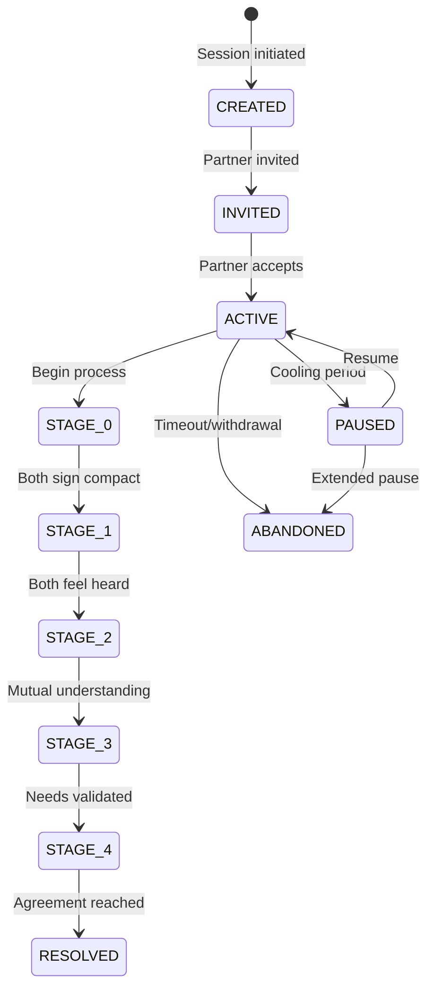

# State Machine

Session lifecycle management and stage-scoped data access rules.

## Documents

### Session States
Session lifecycle FSM with state transitions and required invariants

### Stage Gates
Advancement conditions linked to stage documentation (see below)

### [Retrieval Contracts](./retrieval-contracts.md)
**Critical** - Per-stage data access rules that enforce privacy

## Core Concept

The State Machine Layer enforces:

1. **Session Lifecycle**: Created → Active → Stages → Resolved
2. **Stage Progression**: Gate conditions that must be satisfied
3. **Data Access Rules**: What can be retrieved at each stage

## Key Principles

| Principle | Implementation |
|-----------|----------------|
| Parallel work in Stages 1-3 | Each user progresses independently |
| Sequential work in Stages 0 & 4 | Requires real-time coordination |
| Gate enforcement | No advancement until conditions met |
| Retrieval contracts | Hard rules on data access per stage |

## Session States (MVP requirements)

| State | Entry Condition | Exit Condition | Notes |
|-------|-----------------|----------------|-------|
| CREATED | Session created, invitation generated | Partner accepts invitation (→ INVITED) | No chat allowed |
| INVITED | Partner has link, not joined | Partner joins (→ ACTIVE) or expires | Sender can resend |
| ACTIVE | Both users present | Stage 4 resolve → RESOLVED; pause → PAUSED; timeout → ABANDONED | All stages run here |
| PAUSED | User-initiated cooling | Resume call → ACTIVE | No chat; can view history + emotions |
| WAITING | One user ahead at a gate | Partner catches up → ACTIVE | Derived from StageProgress |
| RESOLVED | Agreement recorded | N/A | Session locked, view-only |
| ABANDONED | Timeout/withdrawal | N/A | Can be archived |

## Stage gates are milestones

Progress is the set of `participant_milestone` rows (keys: the `milestone` table, typed as
`MilestoneKey` in `shared/src/dto/milestones.ts`). There is no gate JSON (work-keq6 removed the derived
`gatesSatisfied`): the progress DTOs (`GET /sessions/:id/progress`, `GET /sessions/:id/state`) carry
`myProgress.milestones` — every milestone the caller reached, key → reachedAt ISO — and
`partnerProgress.milestones` (GET /progress only), limited to the partner's current stage's keys below
(`PARTNER_VISIBLE_MILESTONES` in `backend/src/services/stage-shim.ts`; the partner's `invitation_sent` is
`true`, never its instant — `PartnerMilestoneMap`; the partner's other milestones are
not exposed). The stage number itself is computed by the stage shim.

| Stage | Required milestones | Reached when |
|-------|---------------------|--------------|
| 0 (Onboarding) | `compact_signed` (+ `invitation_sent` for an inviter) | Invitee: their own `compact_signed`. Inviter (authored the session's invitation): stage 0 stays IN_PROGRESS until `invitation_sent` exists too, and ends at the later of the two instants. `invitation_sent` is written by `POST /sessions/:id/invitation/confirm`, or by the partner accepting the invitation if the inviter never confirmed. Partner signing is reported in compact status, but does not gate the caller's stage. Computed in `stage-shim.ts` (`stageCompletedAt`, `activeStage`; `invitationPending`). `witnessStartedAt` on the progress DTOs is this instant. |
| 1 (Witness) | `feel_heard` | User posts feel-heard true |
| 2 (Perspective) | `empathy_validated` | Session-scoped: written for both once both directions are validated (or the remaining differences accepted via skip-refinement) |
| 3 (What Matters) | `needs_confirmed`, `needs_validated`, `needs_shared` | `needs_confirmed` is the caller's own. `needs_validated` and `needs_shared` are session-scoped: the job writes them for every present human only once ALL have shared (ruling R33), so they never mean "I shared". The caller's own share is `GET /sessions/:id/needs` → `sharedAt` (need_share). |
| 4 (Strategic Repair) | `choices_shared`, `closed` | `choices_shared` when the selections are shared; the stage completes at `closed` (session resolved). |

`POST /sessions/:id/stages/advance` reports the current stage's unreached required milestones
(`unreachedMilestones`). The AI's #312 consent gate (partner needs treated as revealed) keys on the prompt
owner's `needs_shared` milestone (`needsRevealed` in `context-formatters.ts`).

Advancement rule: a user can advance when all gate keys for their current stage are true AND any stage-level preconditions (e.g., Stage 4 only after both Stage 3 complete). WAITING state is derived when one user satisfies gates and the other has not.

[Back to Backend](../index.md)
